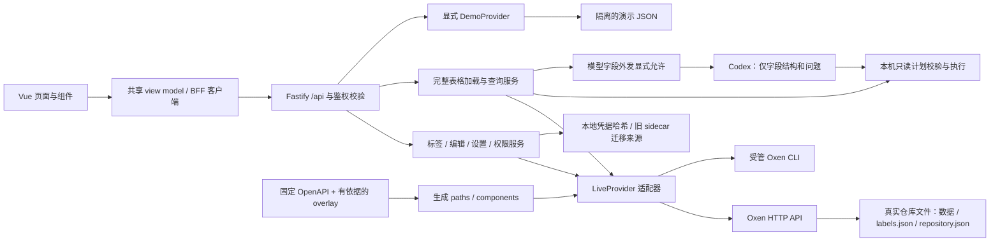

# Oxen Web 架构

本文描述当前仓库中的实现，不将独立界面、BFF 扩展或本地测试等同于 Oxen SaaS 的完整能力。功能基线固定为本次单版本需求；所有页面在同一应用版本集成，不设置只读版本先上线。

## 代码与数据边界

| 层 | 位置 | 职责 |
| --- | --- | --- |
| 页面与组件 | `apps/web/src/views`、`components` | 页面组织、表单、文件树、预览、提交、协作交互；不执行 CLI |
| 应用内协议 | `packages/shared/src/index.ts` | 仓库/文件/提交/workspace 视图模型，`LabelState`、标签配置与赋值、查询计划/结果、仓库策略与权限、任务模型 |
| 前端请求 | `apps/web/src/api.ts` | 同源 `/api` 请求、JSON/上传、会话 Cookie、错误包装和写请求保护头 |
| BFF 路由 | `apps/server/src/app.ts` | 校验输入、调用 Provider、上传限制、任务状态、静态页面及错误归一化 |
| 上游适配器 | `apps/server/src/live.ts`、`provider.ts` | 使用生成类型的 `openapi-fetch` 客户端，将 Oxen 响应转换为共享模型；聚合仓库统计 |
| 规范与生成 | `contracts`、`packages/contracts` | 固定原始 OpenAPI、校验哈希、记录规范修正、生成 TypeScript 类型 |
| CLI | `apps/server/src/cli.ts`、`safety.ts`、`managed-cli.ts` | 受管目录、remote 校验、clone 初始化、参数数组、命令超时/输出限制、任务及串行执行 |
| JSONL | `jsonl.ts`、`import-routes.ts` | 逐行 UTF-8/对象校验、物理行号、类型推断、稳定行 ID；导入真实仓库/分支并提交 |
| 版本化标签 | `labels.ts`、`label-routes.ts` | 自定义单选/多选/文本列、选项/颜色、dataset/file/row 赋值、乐观版本检查及旧标注迁移 |
| 源数据编辑 | `table-editor.ts`、`table-editor-routes.ts` | JSONL/NDJSON 行列变更；源文件与关联标签同 workspace 提交 |
| 仓库设置与权限 | `repository-settings.ts`、`repository-access.ts` | 版本化 repository.json、默认 Web 分支、BFF 可见性/角色/撤销、策略文件写保护 |
| 查询 | `query-service.ts`、`query-planner.ts`、`natural-query.ts` | 固定实际提交、完整表格加载；模型只读计划与本机规则；字段外发显式允许 |
| 历史扩展兼容 | `extensions.ts` | 旧描述/标签 bootstrap 和旧行标注迁移来源；新标签及设置以 Oxen 版本文件为准 |
| 本地环境 | `scripts/oxen.mjs`、`infra/oxen` | 固定 Oxen 版本的安装、启动、停止、健康检查与真实样例初始化 |

BFF 的 `/api/repos` 等路径是本应用内部协议。它们不表示 Oxen 提供相同路径的公开 API。例如，BFF 仓库列表按配置的 namespace 调用 Oxen 的 namespace 级仓库列表，再补充详情。完整上游映射见[契约参考](contract-reference.md)。

## 契约冻结

固定对象为 2026-11-07 获取的官方 OpenAPI **0.67.0**，原始 SHA256 为 `2ae57812994900f768c841e7e20d25418555ffbf37c3690775e2af5b8c581660`。来源与参考 commit 记录在 [`contracts/source.json`](../contracts/source.json)。公开 JSON 是独立发布产物，参考源码 commit 不是其构建来源证明。

`npm run generate:api` 先校验原始规范，再生成 normalized 规范、**35 项**源码核对修正记录与 `packages/contracts/src/oxen.d.ts`。原始文件不被修补；overlay 必须有固定服务端源码依据。该命令不联网升级规范，也不跟随 SaaS 后续改版。另行固定的 Hub 规范只证明其公开契约存在，不代表本地已实现生成/训练后端。细节以[契约参考](contract-reference.md)和 [`contracts/normalization.json`](../contracts/normalization.json) 为准。

CSGHub 仅作为组件、列表/预览及工程组织参考，固定源码索引见 [CSGHub 参考](csghub-reference.md)。实现没有并入其数据模型或复制其源码。

## 路由、状态与视图模型

Vue Router 使用以下路由：

| 路由 | 内容 |
| --- | --- |
| `/` | 仓库列表、搜索、排序、卡片/列表切换、新建 |
| `/repos/:namespace/:repo/files` | 文件树、目录与预览；目录路径放在 `path` 查询参数 |
| `/repos/:namespace/:repo/commits` | 分页提交历史与详情 |
| `/repos/:namespace/:repo/branches` | 分支列表、创建、切换与合并 |
| `/repos/:namespace/:repo/workspaces` | workspace 文件暂存、编辑、上传、commit 和 Push |
| `/repos/:namespace/:repo/annotations` | 可分页条目、关联媒体、自定义标签列及三级赋值 |
| `/repos/:namespace/:repo/query` | 模型生成只读计划/规则查询、执行说明与结果 |
| `/repos/:namespace/:repo/settings` | 版本化描述/tags、默认 Web 分支、可见性及协作者角色 |

仓库路由未指定有效 tab 时显示文件页。有效的 URL branch 上下文优先，否则采用版本化设置中的默认 Web 分支。标注路径、scope、页码及行上下文可随路由保留；旧请求结果不能覆盖新选择。

Pinia 保存应用连接状态、能力、会话动作与通知；Vue Query 缓存仓库列表并在创建后失效；文件、提交、workspace 和表单状态由对应组件管理。UI 消费共享 view model，不依赖原始 Oxen 响应字段。

PDF 预览通过懒加载的 PDF.js 模块与本地 worker 在 canvas 上渲染，支持分页、缩放与适应宽度，不依赖浏览器 PDF 插件。同源原文件请求携带 Cookie；切换文件或卸载时取消渲染并销毁文档/worker，重用 canvas 前等待旧任务结束。

音频和视频使用同源原文件 URL 与浏览器原生播放器，后端适配常见音视频 MIME。能否解码、播放或跳转取决于文件及浏览器，代码路径不替代实际媒体验收。

标注和查询加载时先将所选分支解析为实际 commit ID，再用同一提交读取数据。标签保存捕获加载时的仓库、分支、路径、commit、行 ID 与值，使用 expectedCommit 检查过期版本。切换上下文时清空旧数据并丢弃旧请求结果。

`FilePreview.rowIds` 与 rows 平行，不覆盖原记录字段。JSONL 全文件 id 为唯一字符串/数字时，以类型与业务 ID 的哈希定位行；编辑其他值或排序后保持身份。否则使用规范化内容哈希与重复项序号。上游表格优先使用 `_oxen_id`，缺少时采用内容及全局位置。具体规则和缺少主键的边界见 [JSONL 与标签](labels-and-jsonl.md)。

## 写入与任务

浏览器通过 BFF 调用 workspace API 暂存文件。workspace commit 直接更新远端分支，不能解释成“本地提交后还必须 Push”。优先初始化或复用受管 clone 并调用 CLI workspace commit；CLI 二进制不可用时，可使用已有契约的 workspace merge/commit API。代码不会把虚构命令结果作为成功。

标签、设置和结构化编辑需要精确提交结果，使用有生成类型的 workspace 提交接口。标签配置/赋值保存为 `.oxenweb/labels.json`；JSONL 编辑将源文件及必要的标签 ID 调整写入同一个 workspace，再形成同一 commit。行删除在内置编辑事务中处理其相关标注；其他数据提交留下的历史孤儿赋值不会阻塞后续标签保存。

这些写入检查 expectedCommit、workspace.baseCommitId 和提交前分支 head；标签、设置和编辑服务各自在仓库内排队，Provider 同仓库锁覆盖实际 commit/merge/Push。公开 Oxen 没有客户端提供的全分支 CAS 参数，不能宣称实现了严格全分支 CAS。外部并发修改同一文件仍依赖服务端 workspace 冲突检测。

复杂 CLI 调用采用 `spawn(binary, argv, {shell:false, windowsHide:true})`。命令工作目录必须来自 `OXEN_CLI_ROOT/<namespace>/<repo>`，并通过真实路径和 `.oxen` 元数据检查；浏览器不能指定可执行文件或任意 cwd。CLI 有超时和累计输出上限。`managed-cli.ts` 用 `remote -v` 将 origin 的规范 URL 与配置服务加 namespace/repo 精确匹配，拒绝带凭据、query/hash 或不匹配的 remote。执行前检查工作树干净，避免覆盖受管目录中的额外修改。

缺少 clone 时，BFF 在仓库锁内从可信配置派生远端 URL，clone 到受管 namespace 下的 UUID 临时目录；验证真实路径与 origin 后 rename 为目标目录。失败清理仅针对本次创建且已检查边界的临时目录。新建仓库因此具备初始化受管 clone 的代码路径；其实际可用性仍取决于 CLI、连接、权限和服务兼容性。

`JobQueue` 提供有界的内存任务记录及同仓库队列；`LiveProvider` 另用同仓库 Promise 链，使同步 workspace commit 与异步 merge/Push 共享串行边界。不同仓库可独立执行。任务以 queued/running/succeeded/failed 返回，页面轮询任务 ID。任务记录、会话和锁不跨 BFF 进程或重启保留，因此当前部署模型是单 BFF 进程。

合并的 HTTP fallback 必须执行真实上游接口，并保留所用路径及原因。只有尚未开始远端写入的前置失败才能安全选择另一条路径；merge/Push 后的失败不能无条件重复写入。CLI 受管 clone 的初始化、remote 映射、兼容性以及新建仓库完整写入链路的最终证据，见[集成验证记录](integration-results.md)。

## 持久化

Oxen 管理真实仓库、提交、分支及 workspace 文件。本应用不直接改写服务端 `.oxen` 元数据。

| 数据 | 保存位置及边界 |
| --- | --- |
| 真实版本数据 | 配置的 Oxen 服务；本机部署目录由 `infra/oxen` 管理 |
| 标签列/选项及三级赋值 | 仓库 `.oxenweb/labels.json`；真实 Oxen 提交、分支隔离、后续提交继承 |
| 描述/tags、默认 Web 分支、可见性、协作者角色 | 仓库 `.oxenweb/repository.json`；固定配置分支保存，BFF 读取并执行 |
| 协作者凭据 | BFF `access-credentials.json`；只保存令牌哈希和撤销状态，不把秘密写入仓库版本文件 |
| 旧扩展 | `live-extensions.json`；旧行标注只读，通过显式迁移纳入 labels.json，无法唯一匹配的原记录保留 |
| BFF 创建的 workspace 分支映射 | `live-workspace-branches.json`；公共 workspace 响应没有通用 branch_name，因此保留创建时映射 |
| 演示夹具 | `DEMO_DATA_FILE`；仅 `DEMO_MODE=true` 显式启用，与真实数据隔离 |
| 会话与任务 | 进程内存；重启后需重新登录，旧任务记录不可继续查询 |

本地凭据/兼容映射/演示 JSON 使用进程内串行、临时文件与 rename；新标签和策略的主要持久层是 Oxen 提交。当前仍是单 BFF 进程设计，不提供多进程共享本地凭据文件的数据库事务语义。

## 鉴权与安全边界

BFF 支持实例所有者与独立协作者身份、Bearer 和浏览器 HttpOnly、SameSite=Strict 限时会话；`SECURE_COOKIES` 用于 HTTPS 部署。非回环监听要求至少 16 字符的 BFF 令牌。BFF 身份凭据与上游 `OXEN_AUTH_TOKEN` 分开，浏览器不持有上游密钥。回环环境未设置所有者令牌时保留本地所有者兼容模式；不能把它当作面向不可信访问者的部署配置。

非 Bearer 写请求校验 Origin，并要求 `X-Oxen-Request: web`。输入由 Zod 与路径/ref 校验约束；拒绝穿越、绝对路径、反斜杠、控制字符及 `.git`/`.oxen` 内部路径。原文件代理拒绝重定向，限制累计 25 MB；上传限制 10 MB；文本预览限制 512 KiB。响应带 `nosniff`，SVG 原文件附加 sandbox CSP。文本和表格使用 Vue 插值显示，不执行文件中的 HTML 或代码。

BFF 按 repository.json 执行公开只读与私有隔离，viewer 可读、editor 可写数据/标签、admin 可管理仓库策略与协作者。列表经过权限过滤；导入路由在仓库读写前单独授权；策略文件通过普通上传、workspace 提交或合并绕过管理权限的路径受保护。角色变更和撤销影响后续请求及已有会话。这里的可见性与默认 Web 分支是实际执行的 BFF 语义，不是上游原生 ACL/全局默认分支属性，也不是 SaaS 组织账号体系。

所有 `/api` 请求先检查 `BFF_ALLOWED_HOSTS`，默认仅允许 localhost、127.0.0.1 和 ::1；对外域名必须显式配置。它与 Origin 校验共同限制 DNS rebinding 和跨站写入。受管 clone origin 校验在 CLI 前执行；相应拒绝路径的验证证据见[集成记录](integration-results.md)。自托管上游保持本机监听，绕过 BFF 直接访问上游不会自动继承 BFF ACL。

## 查询与外发边界

`query-service.ts` 固定实际提交后读取完整文本表格，其他表格遍历上游分页；上限 250,000 行，raw 读取仍受代理大小上限约束。超限或分页提前结束返回错误，不以首批数据冒充全表。真实样本规则查询已经验证扫描 2,000 行并得到 label=1 的 1,000 条计数。

规则引擎完全在本机执行。模型引擎通过本机 Codex CLI 接收字段名/类型和用户问题，生成受 JSON schema 约束的只读计划；计划字段、类型、操作与原型路径再由 BFF 校验，过滤、排序和聚合在本机完整记录上执行。没有执行模型生成的 SQL 或任意代码；程序不把数据记录正文附加到模型请求，数据中的提示文本只作为记录内容。

字段结构和问题本身也属于外发信息。UI 的允许复选框默认关闭；`allowExternalSchema` 缺失/false 的模型请求在后端返回 `403 QUERY_SCHEMA_CONSENT_REQUIRED`。用户随后明确允许仅外发结构和问题，真实2000行样本模型计划查询通过：1000条label=1样本、15组attack_family计数。记录正文不外发，模型失败不伪装为规则结果。

## 功能等价性的边界

版本化标签、JSONL 源编辑、BFF 权限、默认 Web 分支和模型计划查询是独立实现的产品能力，不能据此推定与 SaaS 原生任务、控制面、Text2SQL 或其他服务语义相同。原生数据帧未公开的写接口没有凭 REST 惯例补猜；JSONL 编辑采用真实源文件替换与提交。

用户已明确采用原方案的数据管理与协作范围，云生成、微调、部署不纳入本次交付。全站51个功能族仅作参考。用户已确认Chrome登录；但计算机控制无法可靠确认当前浏览器URL，安全停止了后续页面核对。当前代码、公开契约和本地测试不能替代登录后逐屏验收。状态见[单版本验收矩阵](acceptance.md)、[产品快照](product-snapshot.md)及 [SaaS 对照](saas-equivalence.md)。
