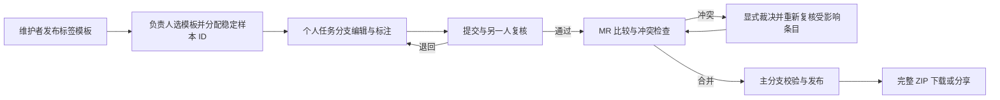

# 数据集、标签治理与协作发布方案（R2 整合评审稿）

日期：2026-11-08，Asia/Shanghai。状态：**R1 与 R2 均已由用户确认，用户已明确要求实施开发；当前按本整合方案实施中**。

设计评审阶段读取了现有页面结构、已有知识库与验收记录，并核对 GitHub/GitLab 官方 Release 文档，当时仅更新本设计文档。用户随后明确授权按前两轮完整方案实施。实施与测试状态另记于 [R2 实施记录](../implementation-r2.md)，不把本方案的拟议能力自动写成已验收；官方 Oxen server/内核仍不修改。

评审追踪：R1 确定标签治理/标注职责分离、任务分支复核、完整 ZIP 发布等基础方案；用户已原则确认。R2 按用户追加要求收敛导航：主页与“公开项目”同级增加授权的“标签管理”；项目取消独立“标注”页，合并为“数据编辑”；按分支自动加载；项目内提供 GitHub/GitLab 形式的 Releases。R2 整体确认后才进入开发，不因 R1 获准提前实施其中一部分。

## 1. 结论与边界

用户提出的分层合理：标签与模板属于规范治理，标注与复核属于生产工作流，数据集浏览与发布属于产品入口。三者权限、页面和版本应分开，但始终共享同一数据集、样本身份和版本上下文。

- 使用现有 Vue 3 + TypeScript WebUI、TypeScript BFF、官方 Oxen 0.67.0 及固定 OpenAPI；不修改或分叉官方 server、存储格式、版本控制内核。
- 提交、分支、工作区、推送与原生合并继续使用 Oxen 能力。Oxen 提供类似 Git 的协作方式，但本项目版本对象是 Oxen commit，不承诺 `.git`、Git wire protocol 或 GitHub PR 兼容。
- 标签目录、任务、复核、样本工作台、ZIP 内容比较、发布与分享属于本项目的 Web/BFF 扩展，明确自己的契约，不伪装成官方 OpenAPI。
- 当前版继续聚焦文本、表格/JSONL 与 ZIP Skill；图片、音频、视频样本管理以及云训练/部署不纳入。
- 全部经确认的扩展在同一交付版本集成；下文依赖顺序是内部开发顺序，不拆成两次上线。

## 2. 现状与缺口

| 项目 | 本轮只读核对的现状 | 本次需要补齐或调整 |
| --- | --- | --- |
| 四类样本 | 已导入 6,719 条：敏感数据 2,000、提示词注入 2,000、行为漂移 1,719、Skill 1,000 | 自动识别现有规范样本入口，不要求再次选择文件或导入 |
| 样本身份 | 四库有可追溯稳定标识；后端标签实际使用稳定 rowId，而非页码/行号 | 编辑、分工、复核、合并、检索与导出统一使用此身份 |
| 标签与预设 | 有六套预设、三级赋值及固定版本标签快照 | 独立治理模块、组织级另存、发布版本、职责分离及旧格式适配 |
| 权限 | 仓库 read/write/admin；write 可维护列/模板并赋值 | BFF 能力细分，统一覆盖专用路由、整包保存及通用文件写入等入口 |
| 多人写入 | 标注重写共享 labels.json，样本编辑重写共享 JSONL；有旧版本写入保护 | 按稳定样本拆分版本记录，任务分配与三方语义比较；不能声称分支天然无冲突 |
| 数据集入口 | 主要仍以文件/表格入口使用 | README 概览、直接样本工作台、统一查询/筛选/编辑/标注 |
| ZIP | Skill 已逐样本 ZIP 存储；可只读列目录、预览限量文本 | 通用网页 ZIP 导入、两个固定版本的成员内容比较 |
| 工作流 | 已有本地 MR；标签中的状态字段不是真实审核流程 | 任务分配、独立复核、退回/通过、版本绑定、进度和审计 |
| 标注粒度 | 数据集、文件、条目三级赋值 | 字符片段和结构化步骤级标注 |
| 检索与发布 | 有样本规则查询、标签快照导出 | 全表标签检索、源记录与标签联合导出、完整发布包和下载分享 |

这里沿用既有导入与验证证据，没有重新跑测试或操作页面。源数据中的真值、分类和 review_status 不算人工已标注或已审核；现有四库不能据源字段被自动计为工作流完成。

## 3. 页面与日常路径（R2）

### 3.1 首页导航与标签管理

保留当前首页的项目工作空间与公开项目入口，在其同一级增加“标签管理”，不另设全局发布中心；Releases 属于具体项目。导航示意：

```text
首页主导航：项目 | 公开项目 | 标签管理〔有规范管理权限才出现〕
项目导航：  概览 | 数据编辑 | 任务与复核 | 版本与合并 | Releases | 设置
```

“标签管理”的位置不改变项目或规范的访问范围。普通标注者、普通复核者与查看者看不到这个 Tab；直接打开其地址或调用管理接口同样拒绝。项目负责人身份也不自动获得整个组织的规范管理权。实例管理员可授权，指定维护者只维护获授权组织的目录；多组织用户仅能切换其有管理权限的组织。

标签管理页采用“领域导航 + 模板/维度列表 + 详情编辑”的结构：

- 左侧按领域组织：通用；AI 安全，下设安全基础、敏感数据、提示词注入、Skill 供应链、行为漂移。初始复用现有六套预设，领域名称与说明可由维护者维护，默认不引入复杂多层分类树。
- 主区有“标签模板”“标签维度”两个子页，提供 ID/名称搜索、发布状态、适用对象（数据集/样本/文件）筛选与排序。
- 模板详情展示用途、版本、适用范围、维度顺序、必填约束和发布记录；维度详情展示 ID、显示名、类型、释义、选项、历史与弃用状态。
- 管理动作包括新建维度、编辑草稿、从预设另存组织模板、发布新版、弃用、查看影响和处理缺项反馈；用过的已发布定义不能直接删除。
- 此页集中维护数据集/样本/文件标签的**规范定义**，实际赋值仍在具体项目的数据编辑工作台完成，不把私有样本和标签赋值集中展示给无数据权限的维护者。

### 3.2 项目页签

进入项目保留统一的名称、当前分支、实际读取提交、样本数、未保存状态与权限。主标签页如下：

| 标签页 | 主要内容 |
| --- | --- |
| 概览 | 简介、规模、标注/复核进度、当前说明、来源、许可、README 与最新正式 Release 摘要。README 是首页正文；许可未提供显示“未声明” |
| 数据编辑 | 唯一样本工作台，融合内容编辑、三级打标、片段/步骤标注、查询筛选、批量操作和附件查看；没有独立“标注”页或“加载数据文件”控件 |
| 任务与复核 | 我的待办、分工、复核队列、退回原因和进度；打开任务或复核条目进入同一工作台，并携带对应分支/样本/任务上下文 |
| 版本与合并 | 提交、分支、MR、样本/标签/ZIP 差异与冲突处理 |
| Releases | 此项目的版本列表、发布说明、固定内容和数据集包下载；有发布权限者管理草稿、构建与发布 |
| 设置 | 项目权限、数据集所用已发布模板及其他元数据；按能力显示 |

原独立“查询”页也并入数据编辑的查询区，避免编辑、打标和查找样本在不同页面切换。原“文件”及“工作区”技术入口移到高级工具，仍保留真实 Oxen 能力。历史标注/查询深链接转换到同一工作台并保留分支、样本与必要的历史提交上下文；有歧义或对象不存在时明确报错，不静默改用其他版本。

项目常规入口默认概览，以 README 说明用途；任务入口和继续工作入口直达数据编辑。视觉延续现有 SaaS 快照的页头、项目导航、表格密度和共享 tokens，本次改造集中于已确认的数据管理工作流，不引入一套不同的外观体系。

### 3.3 数据编辑布局与操作

```text
项目名    分支选择 ▾    当前提交摘要    未保存 N 项 / 只读状态
概览 | 数据编辑 | 任务与复核 | 版本与合并 | Releases | 设置
搜索 / 条件筛选 / 标签筛选 / 查询 / 清除条件       数据集标签
匹配 M / 总数 N     当前模板及版本     列设置 / 批量标注 / 增加或导入
样本表格：ID、原字段、关键标签、任务/复核状态      右侧：当前样本详情
分页与选中数量                                  正文 / 标签 / 附件 / 记录
未提交修改摘要                                  保存草稿 / 提交变更
```

- 查询和筛选只是当前数据集视图，清除条件即可恢复全部条目；“我的任务”是明确显示的筛选条件，不会改变底层样本集合。
- 单条内容编辑与标签赋值共用稳定样本身份和草稿/提交保护。详情区支持上一条/下一条、长文本、嵌套对象、片段和步骤标注；当前工作标注、已采纳结果和源真值清晰区分。
- 数据集标签通过工具栏“数据集标签”抽屉填写；选中样本时直接填写样本标签；在附件详情或“更多 → 数据资源标签”中填写文件标签，使用友好资源名。各处明确对象与作用层级，互不隐式覆盖，不需要单独“标注”Tab，也不要求进入物理文件树。
- 普通用户可查看当前模板的释义并选择允许的选项、反馈缺项；没有新增维度/选项、修改模板结构的按钮。项目负责人可在设置中选择或升级允许使用的已发布模板，规范编辑仍只在首页标签管理进行。
- 批量操作区分“本页选中 N 条”和“全部匹配 M 条”，展示实际目标范围并校验任务权限，不能静默影响未分配条目；保留字段/身份不因批量操作而改写。
- 只有打标权限时正文只读；历史提交/Release 视图整体只读；草稿绑定身份和数据版本，不能切身份后暴露或带入另一分支。

### 3.4 自动加载、版本一致性与异常

用户选分支后，BFF 自动解析该分支实际提交，使用此提交中的数据集描述组合基线、样本覆盖、标签、模板快照和附件，得到完整逻辑数据集。服务端覆盖全部授权条目，前端分页展示；不为了“加载全部”一次性把所有记录和 ZIP 正文塞进浏览器。

**分支是可前进的工作线，提交才是固定快照，Release 是带名称和说明的固定发布版本。** 一次浏览中的分页、计数、查询和编辑都固定到同一提交。其他人推进分支时显示“有新提交，刷新查看”，不直接替换正在编辑的内容；保存以原基点检查，冲突保留草稿并给出差异。本人提交成功后刷新到新提交并保留仍有效的筛选/选中样本。

切分支、离开、切身份、升级模板或刷新到新提交前统一检查正文/标签/片段/步骤草稿，提供“提交后切换、保留草稿后切换、放弃草稿、取消”。保留草稿只留在原身份/项目/分支/基点/规范上下文，返回时验证后恢复；历史/失效模板或已撤销权限不能借草稿恢复写入。提交中阻止重复操作和上下文切换。

区分加载中、空数据集、筛选无结果、无权读取、分支不存在、描述缺失、解析失败与网络失败。分支不存在不自动回退主分支；描述缺失不显示文件选择器让标注者猜入口，向负责人显示修复/导入配置提示。已有四库从当前清单兼容识别，不要求重新导入，也不默选第一个 JSONL。

日常不显示 data/ 路径，不要求连接数据库、选择数据文件或再次连接当前项目。管理员高级入口保留物理文件排障；原始归档和托管基线默认只读，不能绕过身份、标签与物化校验。替换基线需显式迁移。README 不计入样本数。

已有 bundle-manifest.json 是导入基线证据。当前数据集描述记录样本入口、稳定身份、README 和附件映射；编辑后重新计算当前提交内容摘要，不用导入时的旧哈希代表最新数据。

## 4. 标签治理与权限

### 4.1 人员职责

| 角色 | 规范维护 | 样本工作 | 协作与发布 |
| --- | --- | --- | --- |
| 管理员 | 指定维护者、发布/停用组织规范、组织权限 | 由显式数据权限决定 | 管理成员、权限、发布和分享策略 |
| 标签维护者 | 编辑维度/选项/释义，维护模板草稿并发布新版 | 不因维护角色自动获得私有数据读取权 | 处理“缺少标签/选项”的反馈 |
| 数据集负责人 | 选择已发布模板、显式升级数据集/任务所用版本 | 编辑说明，必要时参与样本工作 | 分配任务、确认冲突、合并、发布、管理分享 |
| 标注人员 | 无定义/选项/模板修改权 | 在授权任务内编辑样本、选择标签、添加备注、提交复核 | 在自己的任务分支提交并发起 MR |
| 复核人员 | 无定义/选项/模板修改权 | 查看证据、复核、退回或提出修订 | 不能仅靠“复核人员”角色发布整个数据集 |

角色可以组合，但默认禁止自己复核自己的标注。普通查看者继续只读。数据编辑和标签赋值是可独立授权的能力；负责人可以为某任务只开放打标，也可以同时允许改样本正文。

权限由 BFF 校验，隐藏按钮只是界面结果。需检查标签维护接口、整体 PUT、workspace 上传/写入/提交、CLI 作业、MR 合并的受保护变更；标注者不能通过直接写 `.oxenweb` 文件改变规范或冒充审核人。操作者从登录身份取得，不能接受客户端任意 actor 字段。

组织成员、权限及任务分配/撤销/允许操作以 BFF 受保护控制面的当前版本为准，不跟着任意工作分支切换。工作分支中的任务快照用于追溯，不能恢复已撤销权限或扩大分配范围。组织标签目录由 BFF 自有持久化控制面维护，已发布规范的引用和快照写入数据集版本，不把权威目录放入标注者任意可写的分支。改变这些对象仍需对应权限。所有变更记操作者、时间、对象、前后版本和原因。

以上是本项目的 Web/BFF 权限，不是对官方 server ACL 的改写。后续真实多人验收必须用独立身份；本机 owner 的三个标签页不能当作三个人。若绕过 BFF 直接访问上游或在机器上运行 CLI，BFF 不能替代上游/操作系统的访问控制。

### 4.2 维度的最小充分模型

创建维度默认只填五项，不把管理员表单做成复杂本体编辑器：

| 字段 | 示例 | 约束 |
| --- | --- | --- |
| id | source | 英文 snake_case，组织内唯一；发布后稳定，不复用旧 ID |
| displayName | 来源 | 面向标注人员，可在新版本改名 |
| type | multi | single / multi / text，默认选项型；已有数据时禁止静默改类型 |
| description | 样本最初取得的渠道；非攻击目标或当前保管位置 | 可包含判定边界和一个合成示例 |
| options | public_dataset=公开数据集、internal_collection=内部采集、synthetic=合成、user_submission=用户提交、unknown=未知 | 单/多选必填；每项有稳定 id、显示名，可选简短说明 |

系统自动维护版本、草稿/已发布/已停用状态、创建者和修改时间；排序为可选设置。模板负责各维度在当前任务中的适用层级、是否必填和展示顺序，避免某维度在所有数据集上全局强制必填。片段/步骤标注使用模板明确允许的维度和目标类型。

标识、显示名称与释义分离，借鉴 [W3C SKOS 的标记与文档属性](https://www.w3.org/TR/skos-reference/) 的思想，不要求实现 RDF/OWL。source 等是本项目可理解的英文标识，不宣称存在适用于所有 AI 安全样本的唯一行业字典。来源类别与原始 URL/文件哈希等来源证据分开存放。

未填写、未知、不确定、不适用是不同状态，不互相替代。用过的选项只能弃用、不能物理删除并复用 ID；历史记录仍按当时版本展示。

### 4.3 模板与预设

模板包含 id、名称、领域、用途说明、版本以及维度绑定。保留通用、AI 安全基础、敏感数据、提示词注入、Skill 供应链、行为漂移六套预设，以现有字段审查和复用为起点，不另造一套重复字段。

默认工作台突出少量必需维度，例如来源、风险类别、判定及证据备注；专项维度按领域展开。源真值、预期行为、观察行为、攻击是否成功与人工安全判定继续分开，不依据“positive/negative”或文件名自动推断恶意。

组织维护者在首页“标签管理”中从预设另存组织模板，编辑草稿后发布不可变版本。数据集引用已发布的确切版本，并保存所用规范快照以保证历史与离线导出；新任务默认沿用此版本，也可由负责人选其他兼容的已发布模板。数据编辑工作台默认直接呈现数据集/任务绑定的模板，不要求每次重新选择；未绑定任务的授权标注可选择负责人允许的已发布模板。工作台不能新增选项或改释义，缺项反馈交给维护者。消费接口只提供当前项目/任务授权的已发布规范，不因此开放全局治理目录、草稿或其他组织的模板。

发布新版不会自动改变正在标注的任务；负责人查看兼容性与影响后显式升级。旧版本及已用选项继续可读。旧 labels.json 的中文选项值通过明确映射升级；不重新猜测已存在的人工结论。旧模板“应用后任意编辑者修改”的规则被本草案的治理分层替代，获批后才更新正式知识库。

## 5. 多人分支、任务和复核



### 5.1 1000 条、三人协作的具体方式

1. 负责人选择同一个基线提交和模板版本，以稳定样本 ID 分成 334 / 333 / 333 条。任务显示明确条目集合、执行者、复核者、允许操作和任务分支；不按可变页码或行号分工。
2. 三人分别进入个人分支，只处理分配条目；多人可以同时工作。默认对同一轮任务使用互斥分工；双人独立标注模式必须明确允许重叠。
3. 保存草稿、正式提交和“提交复核”有明确状态，不能把未提交的本机草稿算为任务完成。失败或旧版本冲突显示可恢复结果，不盲目重试。
4. 另一名人员复核；有问题退回，通过后 MR 才具备合并条件。负责人可逐个合并，不必等三个人同时完成。原生分支提交及审计记录保留。
5. 合并后重新检查剩余 MR 的源/目标版本、样本内容和任务状态，最后以通过发布校验的主分支固定提交生成版本。

**分支隔离不保证没有冲突。** 当前所有人改同一个 labels.json/JSONL，即使条目不重叠也可能冲突；同一条样本、同一标签字段、删除与编辑以及规范不兼容仍需裁决。设计目标是减少无关冲突，并让真实冲突可见、可恢复。

### 5.2 版本记录与合并设计

- 不再让每次打标重写全量共享标签文件。按稳定样本和执行人保存标注记录，复核另存；正文增删改保存逐样本覆盖记录，包含基线内容摘要，删除使用 tombstone。数据集/文件级标签也按目标分开存放。共享原始 JSONL 保留为基线。
- Web 查询、预览、diff 和发布使用同一个确定性物化器，将基线与当前提交的覆盖/标签合成为最新逻辑数据集。新增样本只生成一次身份；分页、排序和编辑正文不改变身份。不在每次保存时重写共享计数或汇总索引。
- 稳定 ID、原始来源和源真值默认受保护；普通标注不能将原真值改成人工结论。必要的源数据纠错须有负责人授权并保留原值、理由与变更版本。
- 一次需要同时变更的样本内容、标签和关联信息通过同一 workspace 提交；记录 expected head，避免部分成功。索引只是可重建缓存，不充当真值。
- 原生合并负责分支与祖先关系；Web/BFF 在共同基线、源、目标上按样本和字段三方比较。单侧改变/两侧一致可合并；同字段不同值、删除对编辑、悬空附件或不兼容规范必须阻止自动合并并显示差异。
- 已安装 CLI 0.67.0 的只读帮助确认 merge、merge --abort 与 checkout --ours/--theirs；固定 [官方 merge 命令源码](https://github.com/Oxen-AI/Oxen/blob/0d3045335f93d77171f95f599a3cee3a080622ae/crates/oxen-cli/src/cmd/merge.rs) 也有 merge/abort 入口。正式实现先在合成仓库验证冲突裁决后的提交保留两个父分支血缘，再接 Web 裁决流程，不能覆盖目标文件后伪报“原生已合并”。
- 若某类冲突无法通过此官方版本支持的操作可靠解决，页面明确阻止并保留恢复信息，不改内核补能力，也不承诺所有冲突自动消失。
- 受控 BFF 写入使用持久化作业/锁及执行前后版本校验。不能把目前进程内锁或 expected head 前置检查称为对绕过 BFF 的所有写入都成立的分布式 CAS。

### 5.3 双人复核与精细标注

默认“双人复核”为 **一人标注 + 另一人复核**；可配置任务使用“两人独立标注 + 不一致仲裁”，后者计算两份真实结果，不能用同一行标签覆盖第一人的意见。是否隐藏他人结果由任务模式明确决定；不把共享可读仓库称为天然双盲。

标准模式以通过复核的标注为已采纳结果；独立双标模式由一致性规则确认或显式仲裁记录决定最终生效结果，物化器不得静默覆盖、拼接或投票猜测。samples.jsonl 输出已采纳结果与其状态；labels.json 保留各人的原意见、复核和裁决证据。尚未通过的意见不冒充已采纳标签。

任务有待处理、进行中、待复核、退回、已通过、已合并等系统状态。它与用户自定义的判定标签分离，不能改一个 review_status 选项就绕过审核。审核记录保存独立身份、时间及所审核的样本正文、人工标注、附件实际内容哈希和所用规范快照摘要；任一相关内容变化使对应审核失效，要求重新复核，同路径 ZIP 替换和规范升级也不能遗漏。其他无关条目的提交不应无故使其失效；审核记录自身的追加不改变被审核内容摘要。

字符片段定位到 JSON 字段路径、源字段摘要和 `[start,end)` Unicode 码点位置，前端显式转换 JS UTF-16 偏移；文本变化后锚点失效，不静默漂移。步骤级标注绑定真实的 messages/steps/tool calls 或稳定步骤 ID；没有步骤结构时不擅自按换行猜步骤。全文与单步骤判定分开。

## 6. 全表查询与标签使用

搜索和筛选在当前数据集工作台完成，可组合源字段、数据集/文件/条目标签、片段/步骤标签、任务和系统复核状态。结果可直接进入同一个编辑/标注详情，不再要求选底层路径。

检索扫描符合当前固定提交和权限的完整条目集合，页面分页与返回条数限制不能伪装成完整搜索；超限明确失败或要求缩小范围。缓存键包含数据集、提交、规范与查询版本，角色过滤由服务端实施。

源字段、源真值、人工标签和工作流状态有独立命名空间；三级标签默认分别显示，可显式按作用层级筛选，不隐式继承或覆盖。规则查询保留有限规则引擎语义。既有模型查询授权仍只允许发送字段结构与问题，不增加记录正文、Skill 内容、ZIP 成员或敏感值上传。

## 7. ZIP 导入与成员差异

通用网页 ZIP 批量导入采用一次性的“识别 → 映射 → 校验 → 确认提交”。优先读标准数据集描述；否则识别 JSONL/CSV/TSV、每目录一个样本或每附件一个样本。多个候选时让导入者在预览中确认；重复 ID、保留字段碰撞、悬空附件、歧义路径不能静默提交。显示预计条数、字段、身份规则、附件映射和容量限制；保存映射供后续直接使用。

原包与来源证据保留。Skill 文件夹按每样本一个 ZIP 封装；已有 ZIP 保持原字节。嵌套 ZIP 作为不透明附件，不递归展开。导入和比较都不安装 Skill、不运行脚本、不访问包内 URL，不将样本指令作为操作指令。

ZIP diff 固定两侧 commit 和附件映射，显示成员路径的新增、删除、修改；比较实际成员内容 SHA-256，不能仅比较压缩包大小或 CRC。UTF-8 小文本可查看逐行差异，二进制/嵌套 ZIP 只显示哈希和大小。相同内容不同路径仅提示“疑似移动”；相同成员内容但 ZIP 字节不同显示为封装/元数据变化，权限变化单独提示。

复用已有不可信 ZIP 边界并增加整个比较任务的实际解压量、时间与并发限制。成员只在受限流中读取，不解压到可执行目录；拒绝穿越、链接、加密、重复路径等不支持输入。受限、损坏或无法读取必须明确显示不完整/失败，不能写成“无差异”。这不是恶意代码检测或无害证明。

## 8. Releases、完整导出与分享（R2）

### 8.1 项目级 Release 入口与详情

采用“版本列表 → 发布详情 → 说明和下载资产”的交互，参考 [GitHub Releases](https://docs.github.com/en/repositories/releasing-projects-on-github/about-releases) 和 [GitLab Releases](https://docs.gitlab.com/user/project/releases/) 的组织方式；具体权限、构建流程和数据集包格式为本项目设计，不照搬其 Git tag/CI 契约。

Releases 属于项目，列表覆盖本项目所有有权查看的已发布版本，不随当前工作分支静默过滤。概览显示最新正式版本摘要并链接到 Releases；没有发布时显示清晰空状态，有发布权限者显示“创建 Release”。读者不看到未发布草稿、构建内部日志或管理按钮。

列表展示版本号（推荐 v1.0.0）、标题、状态、发布者/时间、样本数、固定提交、说明摘要和下载。正式/预发布、最新稳定版有清楚标识；可按版本/标题搜索并筛选，不直接按版本字符串大小猜“最新”。

详情展示完整 Markdown 说明（受限渲染）、上个版本差异摘要、来源分支与固定提交、样本/附件规模、模板版本、构建/发布时间，以及 Assets：完整数据集 ZIP、校验清单和受支持的额外导出。资产显示真实文件大小、格式版本和 SHA-256。查看固定发布数据进入只读工作台，有未保存工作时先处理草稿，不悄悄切换原工作分支。

### 8.2 创建、构建与正式发布

发布表单包含五类核心内容：项目内唯一版本号、标题、来源分支/固定提交、版本说明、正式或预发布。默认从主分支当前提交创建候选，也可显式选择主分支可达的已合并提交；分支名解析后保存确切 commit。预发布不绕过权限、内容完整性或复核校验，不混同未审核工作快照。

推荐引导流程：

1. **保存草稿**：选版本、固定提交、填写说明，可查看与上一 Release 的样本、标签、说明和附件差异。
2. **校验并构建**：检查权限、任务/复核、冲突与附件引用，生成不可变候选包。排队、构建中、失败明确显示；失败保留原因，可重试，不覆盖旧发布。
3. **待发布核对**：展示实际包的提交、条数、模板、大小与校验值，负责人核对说明和资产后点击“发布此版本”。发布动作再次校验权限、候选内容与审核有效性，避免只依赖开始构建时的授权。
4. **已发布**：列表/详情与可授权下载同时可见；正式版本可标记为“最新稳定版”，预发布不能成为最新稳定版。

状态为草稿、排队/构建中、待发布、已发布、构建失败、已撤回。构建成功不直接冒充正式发布；新候选失败不影响已发布版本。如果主分支在草稿/构建期间前进，明确候选仍绑定旧提交；使用新提交需显式更新候选、重新校验与构建。

发布后版本号、commit、规范快照与资产不可替换或复用；补充说明采用有修订记录的勘误，不默改已下载包中的说明。错误版本可以由发布管理者撤回并保留审计；撤回阻止该 Release 资产的后续下载及其分享链接，保留历史记录，不可能收回别人已下载的副本。它不撤销独立的仓库读取/工作快照导出权限，有权限者仍可能从同一 commit 导出；如需停止访问源数据，应另行调整对应项目权限。修复数据需新建版本。“最新稳定版”为明确管理的指针，不能改变某个版本号对应的内容；撤回时同步清除或改选有效正式版本并留记录。

Release 由本项目 BFF 管理发布记录和资产，直接关联原生 Oxen commit；它不要求修改内核，也不承诺自动创建官方 tag。若之后核对固定版本有合适 tag 能力，可作为显式关联，不影响已发布包的身份与不可变性。

### 8.3 工作快照与数据集包

下载与正式发布分开：任意有读取/导出权限的已提交版本都可以导出完整“工作快照”，明确标注未发布及其审核状态。现有未完成人工打标的数据仍可直接下载使用；工作快照不提供正式发布背书，也不包含未保存草稿。

“发布”表示从通过校验的主分支**固定提交**生成不可变数据集产物，不能直接取一个可能继续移动的“最新”分支名。默认必须完成计划内必填标注、独立复核和 MR 合并，数据/标签/附件引用无悬空，未保存草稿与未合并分支不得混入。发布预检明确显示遗漏项、任务和当前主分支提交，不因页面展示“已完成”就跳过服务端检查。

默认交付一个无需运行 Oxen 即可使用的 ZIP：

```text
README.md            当前数据集说明、使用方法、许可/限制
dataset.json         格式版本、发布版本、固定提交、规模、身份与附件规则
samples.jsonl        全部最新有效样本，包含人工标签和附件引用
schema.json          维度释义、选项 ID/显示名、所用模板及版本
labels.json          数据集/文件/条目及片段/步骤的完整标注快照
CHANGELOG.md         本版变更、来源提交与可追溯摘要
attachments/         每个 Skill 样本自己的 ZIP 及其他受支持附件
provenance/          来源清单、转换/导入规则与摘要；原归档可作为显式附加选项
checksums.sha256     发布包内容校验
```

samples.jsonl 使用明确的导出格式版本，分开 sample_id、原记录 data、人工 annotations 和 attachments；不把标签强行覆盖进源字段。dataset/file 标签也完整保存在 labels.json，并在 README 解释关联规则。无附件的数据集可额外导出合并 JSONL，但完整 ZIP 是统一的分享单位。

保留导出时的原始真值和原字段；“最新”来自合并后的样本覆盖和标注，不是导入基线。包内变更摘要不等于携带整个 Oxen 仓库历史：本地完整提交历史仍可查，导出提供摘要、commit、必要审计与来源证据。组织人员信息只导出必要的稳定化身份/职责，不自动公开账号、令牌或组织策略。

只有完整文件、条数/引用/校验核对成功，且发布授权与内容审核仍有效，才能正式发布。固定内容排序与打包规则，记录工具/格式版本，支持重复验证。旧版发布不被新版覆盖。

### 8.4 权限、下载与分享

读取项目/发布、导出工作快照、管理发布、创建分享链接分别校验。已发布内容与下载默认遵循项目读取策略：私有项目保持私有，公开项目按既有公开读取策略展示；未发布候选只向授权管理者开放。标签维护权限本身不授予发布权，普通标注者/复核者不因完成任务自动获得发布管理权。

默认不为私有项目生成匿名公开链接；组织外分享由有权限者对固定已发布版本显式创建带有效期的下载链接，并提供撤销、过期和失效提示。固定版本链接与“最新稳定版”便利入口区分，外发默认使用固定版本，不能悄悄下载成后续新包。BFF 下载接口也检查策略与撤销状态，不直接暴露上游或本机文件路径。

链接需要实际可达的部署地址，127.0.0.1 不是他人的可用地址；提供分享能力不等于擅自将本机暴露公网。直接下载和分享下载分别验收成功/失败、鉴权、断连与校验，不能仅依据接口存在宣称已可用。撤销链接只阻止通过该链接的后续访问，不收回已下载副本，也不改变其他独立授权。

## 9. 兼容与内部依赖

保留四库的原始归档、业务 ID、稳定 rowId、来源和真值；不为隐藏路径而强制搬移原数据。旧标签格式与历史提交可读，新写入使用获批后的版本格式。迁移计划必须给出数量/身份/标签映射、变更预览和回退提交，不静默清空既有赋值。

内部顺序：先验证官方 CLI 冲突恢复能力与 BFF 写入边界；再实现规范/角色/稳定样本记录；随后并行推进数据集工作台、任务复核、检索与 ZIP；最后集成发布、分享和全链路验收。全部功能纳入同一交付构建。

## 10. 完成条件

1. 标签管理与首页项目/公开项目同级；普通标注者看不到入口，直达路由/API 均拒绝。指定维护者仅能管理授权组织，项目管理员不自动获得全局权限。标注者无论界面、直接 API 或 workspace 写入都不能改规范、审批自己、冒充别人或改权限；用独立身份实测。
2. 四个已有数据集选分支后自动打开该版本完整条目，条数和身份正确；README 在概览，日常无 data/ 文件选择、加载数据文件或数据库连接。无独立标注页，编辑/查询/三级标签/片段步骤在同一工作台；旧链接保留上下文。分页/统计/查询不混用不同提交，切分支及身份完整保护草稿。
3. 1000 条按稳定 ID 分成 334/333/333；三分支分别完成、另一人复核、提交 MR、合并后全部结果保留。另造同字段冲突，确认阻止自动覆盖并可恢复，最终祖先关系正确。
4. 组织模板另存、发布、数据集固定引用、显式升级及弃用选项历史显示可验证；普通标注 UI 无规范管理控件。
5. 片段/步骤锚点、内容变更失效、复核失效与退回行为可复现；源 review_status 不能代替系统审核。
6. 跨分页完整标签检索与独立计数一致；源字段/人工标签/系统状态区分，权限和固定版本一致。
7. 通用 ZIP 批量导入展示映射与错误；已有 Skill 每条仍是独立 ZIP。成员真实文本修改可见；恶意路径、损坏和超限不能被标成无差异，不执行附件。
8. 项目 Releases 展示版本、说明和真实资产；不受当前工作分支切换影响。草稿/构建/待发布/发布/失败/撤回有真实持久化状态；版本号唯一，旧包不可被后续编辑或分支推进替换。发布包与固定提交核对条数、完整字段、三层标签、片段/步骤、模板、说明和附件 SHA；离线读取和重新导入不丢数据。真实浏览器下载与可达部署上的分享/过期/撤销分别验收。失败候选和预发布不替换最新稳定版本，权限撤销在正式发布前再次生效。
9. 同一构建完成类型、构建、必要测试及浏览器主路径/空错加载/窄屏验证；SaaS 观察、现有官方能力、本地扩展与未通过项继续分开记录，不提前宣布全等价。

## 11. R2 已确认的整合决定

R1 基础方案已原则确认：职责分离、稳定身份、任务分支、独立复核/MR、逐样本版本记录、ZIP 管理和完整导出均保留；默认一人标注加另一人复核，可选双人独立标注仲裁。通用 ZIP 导入、组织模板另存、字符片段/步骤、全表标签检索及源记录联合导出的扩展不因导航调整而取消，仍在同一交付版实现。

用户已确认整合后的三项交互决定：

1. 首页导航为“项目 / 公开项目 / 标签管理”；标签管理仅管理员/指定组织维护者可见可操作，按领域维护模板和数据集/样本/文件维度；实际打标不在该页执行。
2. 项目导航为“概览 / 数据编辑 / 任务与复核 / 版本与合并 / Releases / 设置”；取消独立标注与查询 Tab，功能并入数据编辑；选分支自动加载完整逻辑数据集，无加载数据文件控件。物理文件/工作区放高级工具，普通人只使用直接工作流。
3. Releases 采用项目级列表/详情/版本说明/资产下载，版本绑定固定提交；草稿、校验构建、待发布核对、正式发布形成明确步骤。已发布包不可替换，支持最新正式/预发布标识；工作快照与正式发布区分，私有项目分享默认受限，外部链接显式创建且需可达部署。

用户已再次确认并授权实施开发，以本整合版作为实施依据，不修改官方 Oxen server/内核。后续追加：项目卡片与列表在“总大小”前增加“样本数”，按项目默认分支固定提交的逻辑条目计数；不能用文件数替代，未配置或统计失败显示未知状态，不能猜作 0。

## 12. 依据与追踪

- [项目当前完成度审计](../completion-audit-2026-11-08.md)、[AI 安全设计](../ai-safety-annotation-design.md)、[界面验证](../ai-safety-ui-verification-2026-11-08.md)。
- [四包导入证据](../benchmark-import-2026-11-08.md)、[OpenAPI/源码契约](../contract-reference.md)。
- [SaaS 冻结知识库](../knowledge-base/oxen-saas/README.md)、[SaaS 等价矩阵](../saas-equivalence.md)。本草案是用户驱动的本地产品设计，不新增未经观察的 SaaS 事实。
- W3C SKOS Reference：仅参考稳定标识、显示标签与释义分离；官方 Oxen 固定提交源码及本机 CLI --help：只读核对 merge/abort/ours/theirs 入口，不代表新工作流已测试。
- R2 公开资料：[GitHub About releases](https://docs.github.com/en/repositories/releasing-projects-on-github/about-releases)、[GitHub Managing releases](https://docs.github.com/en/repositories/releasing-projects-on-github/managing-releases-in-a-repository)、[GitLab Releases](https://docs.gitlab.com/user/project/releases/)，2026-11-08 查阅。仅作发布产品交互参考，不表示本地已具备对应能力，不扩大到 CI、部署、计费或原生 tag。
- 当前页面入口只读核对：`App.vue` 现有“项目/公开项目”；`RepositoryView.vue` 现有独立“数据编辑/标注/查询”。R2 为用户追加设计，不改写 SaaS 冻结观察。
