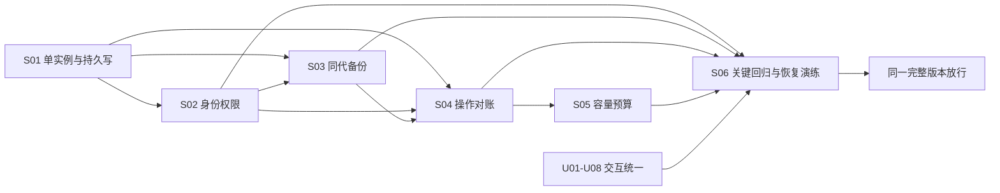

# R9 运行稳定性与交互优化实施提案

**状态：2026-11-08 用户已批准 S01–S06、U01–U08，并采用建议验收目标；R10 正在实施验收。** 本文保留原提案、预算和目标，实际完成情况以 [R10 实施与验收记录](../implementation-r10.md) 为准。备份独立位置、密钥保管和计划时段仍需真实部署配置，批准目标不等于目标已达。字段拖序、序号触发详情、别名表头和字号调整由 R9 独立任务完成。

建议继续使用官方 Oxen 0.67 与现有 TypeScript Web/BFF。以 **3 名标注人员 + 1 名复核负责人、四类共 6719 条样本、单组织、单活动 BFF、内网小团队** 为预算口径。默认批准包为 **S01–S06 + U01–U08**，共 **20–40 人日，即 4–8 人周**。下面的 RPO、RTO、容量和时延都是待确认目标，**不是当前已达指标或服务承诺**。

## 1. 范围与事实边界

本提案保留当前全部业务语义：源 JSONL/CSV 与逐样本 Skill ZIP、稳定身份和 provenance、只读源真值、独立人工意见、领域模板、任务与复核证据、分支/MR、固定版本 Release、分享与可恢复移除。源码、原件、治理定义和人工结论继续分开保存。

允许实施的层面为 Web、BFF、本项目部署脚本与运维工具、合成测试及文档；不修改 Oxen server、基础内核、官方存储格式或既定 OpenAPI。不将远端托管 UI 的编译产物作为实现来源。备份与对账使用官方服务已经提供的读取能力，以及受控停机后的文件级复制；不对运行中的 Oxen 数据库做非官方修补。

| 已有依据 | 可以据此判断 | 本轮仍需证明 |
| --- | --- | --- |
| [R8 实际验收](../implementation-r8.md)：322 项测试，315 通过、7 默认跳过，合成官方服务与浏览器专项 | 当前核心路径已有验证；上述数量属于 R8 历史记录 | 日常并发、故障恢复、整体备份和账号边界；不能由测试数量推定成熟 |
| [身份](../../apps/server/src/auth.ts)、[权限](../../apps/server/src/repository-access.ts) | 已有独立身份、项目能力、会话与撤销机制 | 团队部署配置、完整接口矩阵、恢复后凭据处理；本机 owner 兼容模式不作为团队身份方案 |
| [草稿](../../apps/server/src/dataset-drafts.ts)、[检查点](../../apps/server/src/dataset-ui-state.ts)、[MR](../../apps/server/src/merge-requests.ts) | 已有 CAS、私有隔离、部分原子替换及进程内串行 | 单写者约束、持久写耐久性、跨文件/跨服务中断对账；原子 rename 不等于跨服务事务 |
| [CLI 队列](../../apps/server/src/cli.ts)、[工作流](../../apps/server/src/workflow.ts)、[Release](../../apps/server/src/releases.ts) | 有受限队列、固定证据和中断后的部分失败处理 | 进程中断、回复丢失、资产与索引不同步的可重复恢复；不能假定现在必然丢数据，也不能假定已经覆盖全部断点 |
| [本地服务说明](../../infra/oxen/README.md) | Windows/WSL 下活跃 Oxen 数据在原生 ext4；工程目录旧副本不是活跃权威 | 新机器整体还原及路径核对；不能只复制项目 checkout 或 `data/samples.jsonl` |

本轮只复用[冻结 SaaS 记录](../knowledge-base/oxen-saas/interaction-catalog.md)与[doccano / Label Studio 深研](../research/doccano-label-studio-deep-comparison-2026-11-08.md)，不新增 SaaS 功能推定，也不实施迁移。原来没有通过的上传、下载或上游错误，仍按原记录保留。

## 2. 建议批准的稳定性工作包

1 人周按 5 个工作日计。人日包含实现、联调与相应验收，不包含标注人员实际打标时间。工作包可按依赖并行开发，对外仍集成为同一个完整版本，不另设只读 MVP 或两个上线版本。

| ID | 优先级 / 工作包 | 要完成的具体结果 | 依赖 | 人日 |
| --- | --- | --- | --- | ---: |
| **S01** | P0 单实例与可控启停 | 显式支持单活动 BFF；启动排他检查、根目录/上游身份核对；优雅停写与排空；必要的健康、版本、存储错误和安全运维日志。复用现有 JSON 格式，集中加固持久写，不默认迁移全部控制面到新数据库 | 确认 T01、T03 | 2–3 |
| **S02** | P0 独立身份与权限闭环 | 3 个独立标注身份、1 个独立复核身份，管理员权限单独使用；上游仅受保护入口；角色/能力/任务行范围/所有权的接口矩阵；撤销与凭据轮换、恢复后的身份处置 | S01；T01 | 2–4 |
| **S03** | P0 同代备份与可还原验证 | 一键受控停写/停服务、完整清单和校验、两份备份副本、隔离还原工具与步骤；包含 Oxen 及 BFF 的同一备份代，不止源码和样本文件 | S01；S02；T02、T03 | 3–5 |
| **S04** | P0 故障对账与安全重试 | 为现有高影响写操作记录持久操作 ID、基点、结果与核对线索；明确成功、失败和待核对；回复丢失/远端完成后本地失败可查；重复请求不会盲目再 commit/merge/publish；建立中断点恢复流程 | S01、S02；S03 的备份清单 | 4–6 |
| **S05** | P1 当前容量与并发预算 | 固定四用户负载和数据体量，测全表过滤/排序、草稿、复核、ZIP 和发布；按结果加重操作并发、队列、内存和请求预算；超限明确拒绝，不扩大既有格式/大小范围 | S01、S04；T03、T04 | 2–4 |
| **S06** | P0 关键自动化与发行门禁 | 现有回归继续运行；增加关键浏览器链路、实际合成上传/下载、故障注入、备份还原及干净升级回归；形成可复现报告和单版本放行检查 | S02–S05；交互项可并行接入 | 3–5 |
| | **稳定性小计** | 不含下文纯交互优化 | | **16–27** |

### S01：单活动实例的可测边界

- 同一权威数据集只能有一个活动 BFF。第二个实例指向相同控制面时启动失败并给出明确原因；不得靠进程内 Promise 锁宣称多进程安全，也不支持多个主机共享目录同时写。更换控制目录不能被当作绕过部署边界的正常方法。
- 正常关闭时先拒绝新写入、允许已有读取和受控排空，再关闭 BFF；未排空的操作保留持久线索并转待核对。停止官方服务由既有受管脚本核对进程，不停止整个 WSL 或无关进程。
- 控制面写入采用明确的临时文件、完整校验、替换和目标平台可用的 flush 策略。磁盘满、权限拒绝、进程 kill 均不能使已确认保存的文件变成半截 JSON。若平台不能证明断电耐久性，应明确只通过进程故障测试，不把 kill 测试说成断电认证。
- 健康检查区分“进程活着”“上游可读”“当前允许写入”“备份/对账待处理”。日志只记操作 ID、actor ID、项目、固定版本、耗时、结果码和必要计数，不记录正文、Cookie、token、ZIP 成员内容或原始查询问题。

### S02：账号与能力验收矩阵

管理员令牌用于管理及应急，不由日常标注人员共用。现有 owner/角色/能力机制继续使用；本轮不强制建设 SSO。若管理员也是复核负责人，日常复核使用独立的受限身份，不允许以管理员入口替代禁止自审规则。

至少覆盖以下情况，拒绝结果必须由 BFF 返回，不能只检查按钮隐藏：

| 用例 | 必须达到的结果 |
| --- | --- |
| 匿名或无项目权限读取私有项目、原件、附件、Release 与回收信息 | 拒绝；项目目录也不泄露该项目 |
| 标注者调用模板维护、项目管理、角色修改和其他人的私有状态接口 | 拒绝；本人没有“另一个身份的草稿”可读取 |
| 标注者在任务分配范围外修改正文、样本/文件标注，或自审自己的结果 | 拒绝，不产生工作区或提交，不改变审核证据 |
| 撤销成员、修改能力、已有会话继续写入 | 后续请求立即采用最新授权，不靠重启生效；正在提交的关键步骤重新检查 |
| `POST` / `PUT` / `PATCH` / `DELETE` 及对象归属检查 | 都有正反例，包含项目、条目、annotation、导入、下载、模板、回收和检查点，不漏某种写方法 |
| 已撤销写权限、但仍可读取的本人输入 | 按既有检查点语义可取回/保留；不能应用为数据或发布。撤销读取后，取回也拒绝 |
| 服务重启或整体恢复 | 要求重新登录；不恢复浏览器会话，不因无效凭据回退为 owner，不使历史已撤销凭据重新可用 |

### S03：一致备份必须包含什么

每个备份代使用一个 generation ID，只有清单、全部对象、校验和及还原预检均完成，才能标记“备份完成”。不存在“先备 Oxen，改天再备 BFF”这样的成功状态。

| 一起纳入的内容 | 重要性 / 处理方式 |
| --- | --- |
| 官方 Oxen 的实际活跃存储根 | 完整保留仓库对象、所有分支/提交、工作区及版本化扩展文件；Windows 从受管指针找到 WSL 原生 ext4 数据，不能误用迁移前副本 |
| BFF 权威控制面 | `governance.json`、`access-credentials.json`、`annotation-tasks.json`、`merge-requests.json`、`merge-resolutions.json`、`repository-policy-branches.json`、`repository-activity.json`、`repository-recycle-bin.json`，以及实施后的操作日志/对账状态；实际路径从运行配置解析，不能凭默认路径猜测 |
| Release 索引与资产 | `releases/records.json` 与其引用的完整资产目录同代保存，核对每个文件的大小、SHA 与固定提交；分享授权记录按敏感数据保护，避免恢复后意外开放旧分享 |
| 私有草稿与 UI 检查点 | `dataset-drafts/`、`dataset-ui-state/` 及 actor/repo/ref/kind 命名空间，保留非法或未完成的输入原样，不把它们升级为已提交数据 |
| CLI checkout 与尚未结束的导入/构建 | 干净且可重建的缓存可排除，但须先证明没有未推送提交、未提交文件或用户输入；有未完成工作则保留受限快照，或显式列为需要重新操作。内存预检会话不冒充可恢复任务 |
| 版本、配置定位与密钥材料 | Web/契约/官方二进制版本和校验、存储指针、配置键及密钥引用进入清单；必要密钥单独加密保管。源码仓库、公开文档与验收截图不包含这些秘密 |

建议的一致性切点是：**BFF 停收新写 → 排空/登记在途操作 → 停 BFF → 受管停止 Oxen → 确认无其他写入者 → 复制同代数据与控制面 → 校验清单 → 启动同版本服务并复核**。不默认承诺不停写热备；运行中跨 Windows/WSL 复制若没有可证明的共同快照点，不作为可恢复备份验收。

还原在隔离目录、不同端口与原生文件系统中进行，先离线核对清单，再启动匹配版本，不能覆盖现用目录试运气。检查至少包括：仓库/分支 HEAD、稳定 sample ID 集、逻辑条数、原 JSONL/ZIP 哈希、当前标签与已采用模板、任务/复核指纹、MR 状态、Release 索引/资产、回收状态、本人草稿/检查点归属。恢复成功不能仅以首页打开为准。

恢复期间默认关闭团队外部访问和分享。保留 actor ID，不把旧意见记到新人员名下；轮换/禁用备份中的成员凭据，或经可证明的最新撤销清单核对后再启用。无法证明撤销状态时，不直接恢复旧 token 的有效性。浏览器会话和内存 JobQueue 不作为已恢复状态；未完成操作走 S04 核对。

### S04：故障对账，不承诺跨服务“天然 exactly-once”

对现有样本正式提交、README/项目元数据提交、模板采用、导入提交、merge、Release 构建/发布等操作，持久记录操作 ID、actor、项目、目标分支、expected HEAD、请求内容摘要、workspace/commit/job/asset 标识、状态与核对结果。摘要只用于一致性，不把数据正文写入运维日志。相同操作 ID 携带不同摘要应拒绝。

重试只能返回已核验的原结果、继续安全可证明的一步，或明确“待核对”；不能在未知状态下再次写入，也不能用一条成功 toast 掩盖远端完成但本地未登记。它是 BFF 操作协调机制，不改动 Oxen 原生事务模型。

| 注入断点 | 验收结果 |
| --- | --- |
| 草稿/检查点临时写入或替换前后中断 | 旧完整版本或新完整版本可读；身份和 revision 不串；未确认写入不报已保存 |
| Oxen commit 成功、HTTP 回复或本地结果登记丢失 | 能通过操作锚点、固定基点及目标提交核对；重试不额外产生相同提交，无法确定时保留输入并停止自动重做 |
| merge 已完成、MR/任务状态更新失败 | 不再次 merge；检查目标提交与证据后对账，不能凭分支名直接把任务标成已复核合并 |
| Release 资产已写、索引尚未写，或反向不一致 | 不发布半包或错误链接；引用资产缺失/hash 不一致使预检失败，孤立临时资产可核对，不删除仍被引用的原件 |
| 进程重启、CLI 超时、上游暂不可达 | 原在途状态变成待核对/明确失败；不会把超时等同远端未执行，不自动放宽权限或 CAS |
| 备份代缺文件、凭据/任务与 Oxen 分支不一致 | 还原预检失败或明确进入人工核对；不能以“部分可用”标记整体验收通过 |

### S05：容量测试应对应当前团队

不以代码中的 25 万行上限作为吞吐保证，不把现有单次导入/包体限制自动调大。第一轮用无敏感内容的合成数据匹配四类结构与当前规模，记录行大小、嵌套深度、长文本、ZIP 数量和总字节；以 T03 的机器规格、实际附件规模和 T04 目标为固定测试条件。

建议场景：4 个独立身份运行 30 分钟，3 人分别编辑/标注任务分支，1 人查看和复核固定提交；每人进行分页、全表筛选/排序、打开详情、10 项编辑后的草稿保存及明确提交。另测 1 个受限重操作与这些读取并行，分别覆盖追加导入、包内 diff、Release 构建。用户量、写入节奏、操作数、源/逻辑字节和缓存冷热必须进入报告。

同一批场景重复 3 轮，观察 BFF RSS、排队、错误率和超时；不得通过删附件、缩短真实结构或取消权限检查来满足指标。遇到超预算先限并发/明确拒绝并保留输入，再报告哪一项预算限制了使用；未知规模另行确认，不静默承诺企业级大规模。

### S06：以关键风险为中心的回归矩阵

- **每次变更**：现有类型/构建/单元与路由回归、固定 OpenAPI 生成一致性、干净依赖安装；已有 live skip 单独列明。
- **合并与发行前**：Windows/WSL 官方 0.67 的合成端到端；独立身份 → 草稿/检查点恢复 → 一次提交 → 另一人复核 → 内容/规范/ZIP 变化使复核失效 → merge → 固定 Release → 实际下载并校验条目、标签、说明及附件。
- **浏览器关键流程**：实际合成文件上传、预览与追加、跨页/筛选选择、合法与非法输入、离开/刷新恢复、多窗口 CAS、权限降级、README 历史/diff、回收恢复；包含桌面与 390px 窄屏、键盘焦点与错误状态。文件上传按钮出现不能代替上传成功；浏览器下载被审批阻止就记为阻塞，不能计入通过。
- **恢复与故障**：S04 每个断点至少一个可重复用例；损坏/缺失备份清单必须失败；一次隔离整体恢复并核对样本和控制面。故障注入只在可销毁合成库、私有测试目录和独立进程执行。
- **不可信数据**：JSON 字段、提示词、Skill 文本及嵌套 ZIP 只作为 DATA；回归确认不执行脚本、不安装 Skill、不自动访问样本 URL，不向模型发送记录正文。

以上不要求为每个样式变化写镜像测试；已有有效回归优先复用。S05 负责负载配方和测量，S06 负责把通过的场景变成持续门禁，工时不重复计算。

## 3. 需要确认的目标与默认值

| ID | 建议默认值（提案） | 判定与可调整条件 |
| --- | --- | --- |
| **T01** 身份与拓扑 | 单组织、4 个日常独立身份、单活动 BFF；官方服务只供受保护链路使用。管理员日常权限与应急管理凭据分开 | 不要求新增人员或 SSO；允许同一负责人兼管理员，但禁止共用管理员账号打标、禁止自审 |
| **T02** 备份与恢复 | 已确认落盘的状态 **RPO ≤24h**；从业务不可用或还原演练宣布开始 **RTO ≤4h**。每日同代备份，升级/治理迁移/大批量导入前额外备份 | 都需演练测定。浏览器未发送或未确认保留的输入不纳入 RPO。备份失败跨过 24h 即目标未达，不以“已安排计划”冒充完成 |
| **T03** 存储与维护窗口 | 1 份原数据 + 1 份独立本地备份 + 1 份受限异机/离线加密副本；保留 7 个日代及 4 个周代。建议夜间可控停写窗口 ≤30min | 由用户指定备份位置、密钥保管人与恢复负责人；同一硬盘的两个分区不算异机副本。先量完整历史/ZIP/资产字节及复制速度，再确认窗口/RTO；不以压缩 ZIP 能显著变小作假设 |
| **T04** 交互与容量 | 6719 条基线、4 活跃用户、每次最多 1 个重型导入/构建/ZIP 比较；上述 30min 配方下，普通分页/过滤/排序与合法私有草稿请求 **p95 ≤2s、p99 ≤5s**；意外 5xx 为 0，非预期超时为 0 | 必须记录机器、行/附件字节、冷热缓存、请求节奏。预期 409/413/429 与主动故障分开报告，不能藏进“成功”分母；固定当前支持范围，不承诺任意包体。若要具体 Release 时限，先用约定包体实测后定，暂不捏造分钟数 |
| **T05** 资源与保护 | 基准环境建议可供测试的 4 vCPU / 8GiB 与 SSD；BFF 峰值 RSS 暂以 ≤1.5GiB、连续 3 轮空闲收敛后增长 ≤10%（允许64MiB测量噪声）作为调优目标 | 机器资源尚未核定，不是强制采购。若现有环境不同，先定基准再调整预算；不能拿另一台高配机器的数字冒充当前机器通过 |
| **T06** 重试与保留 | 未知结果不自动重放；已确认的数据不丢失、不同身份不串、旧基点不覆盖。操作/失败记录默认留 90 天，仅保留必要元数据；业务源/版本不按日志期限清理 | 保留期限及磁盘预算可确认后调整。审计不写正文、凭据或恶意载荷；临时包与缓存仅按已证明不再引用的规则处理 |
| **T07** 发布门槛 | P0 风险用例全部通过，S05 达约定预算，一次同代还原演练完成；文档、错误修复路径、版本和权限说明一致 | 不以“测试总数增加”代替门槛。真实样本内容、权限、包结构和回收记录不做自动兼容迁移或清理 |

RPO 按故障时刻与最近一个**已完整校验、可获取的合格备份代的一致性切点**的时间差计算，不采用复制完成时间代替数据切点；RTO 从业务不可用或还原演练宣布开始计算，到权限、样本、控制面和必要下载回读均通过为止。获取备份、密钥和完成预检的时间不能从计时里扣掉；无法获取属于演练失败。T02 的 4h 以事先批准的体量与硬件为测试条件，未知数据体量必须先核定。

## 4. 纯交互优化清单：复用已有能力，不加新业务

下列参考 doccano 的分类/NER快捷操作和 Label Studio 的多问题表单、Data Manager 组织方式，但**只改善当前 UI**。不引入外部平台，不增加 AI 预标注、通知中心、新任务类型、自动裁决、额外标签维度或新的发布状态。

字段拖序、序号触发抽屉、别名表头、字号不在此表，避免对已授权内容再次审批或重复计价。每项均为 **0.5–1 人日**，含对应验证，总计 **4–8 人日**。

| ID | 优先级 | 当前痛点 / 已有能力 | 拟调整（交互层） | 可测验收 | 人日 |
| --- | --- | --- | --- | --- | ---: |
| **U01** | P1 | 已有本机检查点、合法草稿、提交、复核与 Release；多个页面对“保存”的含义仍需用户自行区分 | 统一状态词、按钮动词和就近说明：输入已保留 / 私有草稿已保存 / 已提交；复核、发布沿用各自已有状态。颜色以文字与图标补充，绿色不解释成复核通过 | 用未闭合 JSON → 保留 → 合法草稿 → commit → review → Release 走一遍，每步可说明保存位置与影响范围；无错报成功；不新增状态模型或提交次数 | 0.5–1 |
| **U02** | P2 | 已有快捷键、Tab 和上一条/下一条；新人不易发现，输入与页面快捷键易混淆 | 提供统一、按当前页生成的现有快捷键说明与焦点提示；输入框/弹窗中的按键保持控件语义，关闭面板后回到触发位置 | 只用键盘完成现有选样本、填写标签、预览与取消流程；输入文字或 Enter 不触发意外切行/commit；帮助不列出未实现快捷键 | 0.5–1 |
| **U03** | P1 | 已有标签模板、帮助、必填/可选与高级维度；用户容易混淆项目主题、样本判断及源 truth | 在现有表单中统一主维度/更多信息折叠、选项帮助、空值和只读提示；项目标签就近标“全项目共享”，样本标签标当前分支目标；按已发布定义展示，不猜解释 | 新人能区分 source 原字段与人工来源标签、未赋值与“不确定”；折叠与展开不丢输入；同一选项在表单/摘要/筛选含义一致；标注者仍不能维护字典 | 0.5–1 |
| **U04** | P1 | 已有筛选、排序、候选选择和批量赋值；“当前页 / 已选 / 匹配总量”容易混成一个数 | 统一范围文字和选择计数，批量动作前展示实际选中范围及条数；筛选变更后明确提示仍保留的选择。只说明和约束现有选择，不增加跨全结果一键写入 | 用多页、部分权限和无匹配场景验证；用户看到的候选 ID/条数与实际既有操作一致；变更筛选不会把未选记录一起写入；无新服务能力 | 0.5–1 |
| **U05** | P1 | 已有校验、409、网络错误和草稿恢复；不同页面错误位置、重试说明与修复顺序不一致 | 用统一的就近错误摘要和可聚焦字段提示；已存在的版本/权限/输入错误给出对应操作；未知结果引导“核对操作结果”，不把“重试”一律画成再次提交 | 非法数字、枚举、过期 HEAD、跨窗口 CAS、权限撤销各有准确提示；当前输入保留，焦点可到错误字段；不靠自动改值/自动 rebase 消除错误。S04 接入前不虚构核对成功 | 0.5–1 |
| **U06** | P1 | 已有分支、固定提交、项目级标签及 diff；多处版本条呈现顺序不同 | 统一分支/固定 hash/历史只读的排列与文案，差异页始终按前版→后版表达；共享项目标签与样本当前版本清晰分开；复用现有原始/结构化差异入口 | 在 main、任务分支和历史提交切换，按钮权限与标题一致；不混用两个不同 HEAD 的计数/说明；结构化 diff 超限仍明确提示，不把未比较显示成无差异 | 0.5–1 |
| **U07** | P2 | README、完整 JSON、字段配置都有编辑/预览/核对/提交，但动作位置与离开提示不同 | 统一现有“编辑→核对→明确提交”顺序和主次按钮；离开时优先使用已具备的检查点恢复；需要放弃时明确指出放弃的是哪一层输入 | 三类编辑分别测试取消、离开、刷新、恢复与提交；不会把“输入已保留”误作已提交，也不会为切换预览产生 commit；不建设新的文档功能 | 0.5–1 |
| **U08** | P2 | 已有导入检查/预览/提交及 Release 预检/构建/下载；用户不易分清预览结果与最终产物 | 统一既有流程中的步骤说明、实际计数、阻塞原因和返回入口；进度只使用服务已有状态，不伪造百分比。关闭时说明临时预检是否需要重新选择文件 | 合成 JSONL/CSV/Skill ZIP 预检失败、CAS 变化和 Release 校验失败均可返回正确步骤；预览不提交、失败不报发布；浏览器下载受阻不显示“下载已完成” | 0.5–1 |

U02 只整理已有快捷键，不因参考 doccano 而直接引入其 Enter 确认行为。U03 借鉴多问题表单的可读性，不采用外部可变配置作为治理权威。U04 借鉴数据列表的范围提示，不把按姓名视图或筛选当任务授权。U05 与 U06 保持原有权限、CAS 和审核指纹；这些限制优先于减少点击数。

## 5. 依赖、内部顺序与预算核对

建议内部顺序：

U01–U04、U06–U08 可在稳定性实施期间并行；U05 的未知结果修复入口依赖 S04 的真实对账结果。S06 的基础自动化可提前搭建，最终必须使用各包的实际实现验收。上述是任务依赖，不是两个对外上线阶段。

| 成本项 | 最低人日 | 最高人日 | 说明 |
| --- | ---: | ---: | --- |
| S01–S06 | 16 | 27 | 2+2+3+4+2+3；3+4+5+6+4+5 |
| U01–U08 | 4 | 8 | 8×0.5；8×1 |
| 已知故障与联合验证余量 | 0 | 5 | 只处理上述范围内的断点、平台差异与回归，不挪作新业务或 HA/SSO |
| **总计** | **20** | **40** | **4–8 人周；不把人周误作日历周** |

按 2 名开发与兼职 QA、现有环境可用估算，日历量级约 3–6 周，受备份位置、硬件、恢复演练与问题修复影响。这个区间是待验证工程预算，不是报价或工期保证。若删减 U 项，可逐项扣除 0.5–1 人日；稳定性六包存在依赖，不建议只做“加测试数量”而省去身份、备份和对账。

### 不纳入默认批准包的条件项

| ID | 仅在什么条件下另行设计 | 本轮处理方式 |
| --- | --- | --- |
| **C01** SSO / 企业身份联邦 | 用户要求对接现有身份提供方、统一离职/组同步 | 不以 SSO 为 3+1 团队上线前提；先使用受控独立身份与撤销 |
| **C02** 多活动 BFF / HA / 不停写热备 | 需要跨主机同时写、无计划停写窗口，或可用性要求超出单实例 | 另行评估数据库控制面、分布式协调和持久任务队列；本轮启动检查不能冒充这项支持 |
| **C03** 超出当前包体/并发的大规模 | 实测体量或使用者数量超出 T03–T05，且限流不能接受 | 另行评估流式处理、对象存储与数据访问优化；不为满足数字改 Oxen 核心，也不在本轮擅自提高限制 |

## 6. 批准方式与最终交付检查

建议用户可直接按 ID 批准：**“批准默认包 S01–S06、U01–U08；T01–T07 采用建议值，备份位置与维护时间另行给出”**。也可以列出批准/排除的 U 项或更改阈值。C01–C03 默认不实施，需要另一次明确范围与预算。

需要确定但尚未事实验证的事项为：备份目的地与密钥保管人、维护窗口是否可接受、完整历史/ZIP/Release 的实际字节和基准机器、T02 的恢复时限、日志保留期及最终预算顺序。本文不给用户自动开账号、改监听地址、启备份计划、迁移数据库或停服务；批准后再按已确认环境落实。

最终同版本交付应附以下可核对材料：

- [ ] 一份实际部署/身份与上游访问边界清单，第二活动 BFF 的失败验证。
- [ ] S02 权限矩阵的实际结果，包括各写方法、对象归属、禁止自审、撤销与恢复后凭据处置。
- [ ] 一个成功备份代的非敏感清单、完整校验结果及一次隔离整体恢复记录；RPO/RTO 和复制窗口给出实测值。
- [ ] S04 六类中断点的操作 ID、预期/实际结果和处理结论，证明未盲目重放或错误发布。
- [ ] 四用户容量配方、机器和数据字节、p95/p99、内存/队列/错误记录；不符合的目标如实登记。
- [ ] 关键 E2E、实际合成上传/下载、干净构建与固定契约生成结果；默认跳过、审批阻止和未验证平台分开列出。
- [ ] 每个批准 U 项的桌面/窄屏/键盘与错误状态记录；来源事实、设计选择、实测结果保持分开。
- [ ] 运维操作指南与同一发行版本的回滚/恢复路径；真实数据、凭据和攻击内容不进入公开证据。

## 7. 依据与来源

本提案以本地现状和前轮固定的一手资料作设计依据，不把外部产品的角色名、确认完成或营销功能直接套成当前审核语义。

- 本地事实：[R8 验收](../implementation-r8.md)、[入门与支持边界](../getting-started.md)、[官方本地服务定位](../../infra/oxen/README.md)、[固定 SaaS 页面目录](../knowledge-base/oxen-saas/interaction-catalog.md)、[AI 安全知识库](../knowledge-base/ai-safety/README.md)。
- 审计与成本口径：[doccano / Label Studio 深度对照](../research/doccano-label-studio-deep-comparison-2026-11-08.md)。本文 4–8 人周沿用该报告的小团队增量口径，未加入外部平台部署或迁移费用。
- doccano：[固定版本确认 API](https://github.com/doccano/doccano/blob/ab6b765ea326d07b2b806a4280cd097565e62321/backend/examples/views/example_state.py#L11-L32)、[现有快捷确认控件](https://github.com/doccano/doccano/blob/ab6b765ea326d07b2b806a4280cd097565e62321/frontend/components/tasks/toolbar/buttons/ButtonReview.vue)、[独立/共享标注](https://github.com/doccano/doccano/blob/ab6b765ea326d07b2b806a4280cd097565e62321/backend/labels/views.py#L32-L78)。借鉴交互，不引入其完成确认作为我们的独立复核，也不照搬 Enter 提交含义。
- Label Studio：[Choices 控件](https://labelstud.io/tags/choices)、[数据管理](https://labelstud.io/guide/manage_data)、[版本功能对照](https://labelstud.io/guide/label_studio_compare)。这些资料在前轮研究中已核对；本轮仅采用多问题表单、范围提示和清晰操作顺序，不把商业角色/分配/复核功能写成 CE 或当前自研现成能力。
- 既有编辑与差异依据：[持久编辑输入及差异设计](../research/durable-editor-and-diff-2026-11-08.md)。继续采用原始输入保留、明确提交、固定版本与真实失败状态；不重复实现本轮已直接授权的列顺序、抽屉触发、别名与字号。

本文是已批准的原始实施基线。实施完成与验收状态由 [R10 记录](../implementation-r10.md) 单独记录，不能把上面的目标值或历史复选框当作已经完成。
