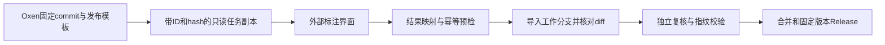

# doccano、Label Studio 与 Oxen Web 深度选型

调研日期：2026-11-08。结论针对现有文本/JSONL、敏感数据、提示词、行为漂移轨迹和逐样本 Skill ZIP；不把图片、音频、视频、云训练列入收益。本文只做公开源码、官方文档与当前工程静态审查，未安装或运行两款候选工具，未读取或传输真实样本，未修改服务或业务代码。改造量是工程估算，未经原型测量。

## 决策结论

**当前建议继续使用官方 Oxen 0.67 + 现有 Vue 3/TypeScript Web/BFF，优先补稳定性；不整体迁移到 doccano 或 Label Studio Community。**

决定因素是已确认的产品模型：版本化样本资产、可维护的领域字典、独立意见与复核、源内容变化后的证据失效、分支合并和固定版本发布。通用标注软件主要节省标注画布、控件、数据管理和基础协作，并不直接提供上述组合。即使从零开始，只要这些要求保留，仍需要 Oxen 一类的版本底座和相应业务控制面。

- **doccano**：纯文本分类、敏感实体 NER、跨度及关系任务的轻量备选。基础分配可以复用，但 Approver 角色名不等于本项目要求的独立审核闭环。
- **Label Studio CE**：组合式多维标注界面最有参考价值；可以保存多人结果，但角色隔离、指定审核和安全的任务分配不能按商业版能力计入。对多维问卷的界面复用价值高于 doccano。
- **当前自研**：领域和版本语义已贴合，但长期维护这些规则、权限与恢复机制是团队自身责任。现有322项测试和真实服务验收不能证明多机、高并发或企业身份体系已经成熟。
- 若将来愿意采用商业软件，Label Studio Enterprise 值得另行询价评估；它可减少角色/分配/复核开发，Oxen 分支发布、源真值与 Skill ZIP 适配仍需保留。商业费用不在本次开源改造成本中。

## 证据基线与判定方式

| 项目 | 本次固定依据 | 判定边界 |
| --- | --- | --- |
| 当前工程 | `v0.1.0`，源码提交 `713c32e8b26be062092282fadf3cef0691e4c48d`，官方 Oxen 0.67；[R8实际验收](../implementation-r8.md) | 已有本地/CI/合成原生验收；本轮不新增压测或企业化认证 |
| doccano | [稳定版v1.8.5](https://github.com/doccano/doccano/releases/tag/v1.8.5)；深入源码固定 [master ab6b765](https://github.com/doccano/doccano/commit/ab6b765ea326d07b2b806a4280cd097565e62321)，并在v1.8.5复查确认API与权限分支 | 分支提交2026-01-17；未归档不代表持续功能路线保证；未实测运行 |
| Label Studio | [稳定版1.23.2](https://github.com/HumanSignal/label-studio/releases/tag/1.23.2)；补读 [develop 6901e937](https://github.com/HumanSignal/label-studio/commit/6901e93759139b361d303064628b3ccc629d7069) | 关键多人模型、计数、配置、只读查看器和editor包在1.23.2复查；develop新增内容不冒充稳定版产品支持 |
| CE/商业差异 | [官方版本对照](https://labelstud.io/guide/label_studio_compare)、[CE用户说明](https://labelstud.io/guide/signup) | “代码里存在基础字段/计算”与“官方提供完整工作流”分开判断 |

本文的“需补”表示未找到符合本项目完整语义的已交付能力，不表示开源源码不能改造。模板、导出和任务一词在不同项目含义不同，不能仅靠菜单同名判定等价。

## 功能复用与缺口

| 需求 | 当前 Oxen Web | doccano 开源版 | Label Studio CE |
| --- | --- | --- | --- |
| 文本分类、实体跨度、快捷标注 | 已有表单/片段；画布、键盘和长文本体验仍可提升 | 成熟文本分类/NER/关系画布、快捷键可复用 | 文本/跨度、Choices/Taxonomy/Rating等控件可复用，多问题组合更灵活 |
| 完整嵌套JSONL、原类型及源真值编辑保护 | 已有逻辑样本、类型/选项、草稿、只读源truth和覆盖记录 | 额外字段可经meta保留，但内置编辑主要针对主text；需通用字段编辑与真值隔离 | data可保存额外字段，Task API可更新；仍需本项目的typed编辑、草稿与truth保护 |
| 领域字典、ID/显示名/说明/选项、发布模板 | 已有组织维护权限、不可变定义、checksum、显式采用 | 项目内标签类型可复用；跨组织领域字典、模板发布和升级规则需补 | XML控件配置可复用；可变project label_config不等同不可变治理模板 |
| 项目主题/行业与条目/文件标签分层 | 已有main统一项目标签和独立样本/文件意见 | 项目Tag及类别不能直接替代双层维度治理 | 项目配置与任务结果可承载部分信息，仍需分层模型和统一检索 |
| 多人结果与分工 | 按actor独立意见、行范围任务与分支 | 有按人结果及加权/随机等分配；独立/共享模式语义不同，写入范围须补校验 | 可存多条按人annotation；已有部分计数。官方CE没有指定任务分配工作流 |
| 独立复核、禁止自审、争议及变更失效 | 已有源/模板/意见/附件指纹和不同复核人 | confirm不是独立批准，需新增审核对象、证据与失效机制 | 指定reviewer/角色工作流属商业版；CE需实现审核控制面与证据 |
| 管理员维护字典，标注者仅消费 | 已有BFF能力检查；团队部署仍须独立身份与保护上游 | 项目角色可参考，但需验证所有写方法和对象范围 | CE用户默认同功能、可见所有项目；需要完整API授权，不能只隐藏按钮 |
| Git式数据分支、MR、固定版本diff | Oxen原生基础加BFF协作记录 | 项目克隆和SQL记录不是分支合并；须保留/接入版本服务 | 任务/导出快照不是分支合并；须保留/接入版本服务 |
| README+源记录+最终标签+复核+附件的Release | 已有固定commit预检、包与校验；受容量上限约束 | 可复用导出转换器，Release、审核门禁和版本说明需补 | 可复用JSON结果导出，完整Release和固定版本门禁需补 |
| 一个Skill ZIP一个sample、惰性查看和包内diff | 已有受限清单、内容/成员hash、只读差异 | 未发现成套能力，需要现有ZIP服务和专用界面 | 同样需要ZIP服务和专用界面，上传附件不代表安全审查工作流 |
| 工程基础和运维 | TS/Vue3/Fastify，当前部分控制面为文件存储 | Django/ORM/Celery等可复用；Nuxt2/Vue2不是当前同栈组件 | Django/数据库、React编辑器/SDK可复用；引入Python及React维护面 |

上述doccano细节来自[导入模型](https://github.com/doccano/doccano/blob/ab6b765ea326d07b2b806a4280cd097565e62321/backend/data_import/pipeline/data.py)、[标签模型](https://github.com/doccano/doccano/blob/ab6b765ea326d07b2b806a4280cd097565e62321/backend/label_types/models.py)、[分配策略](https://github.com/doccano/doccano/blob/ab6b765ea326d07b2b806a4280cd097565e62321/backend/examples/assignment/strategies.py)。Label Studio数据和控件依据[导入](https://labelstud.io/guide/tasks)、[Choices](https://labelstud.io/tags/choices)、[Taxonomy](https://labelstud.io/templates/taxonomy)、[官方CE数据管理](https://labelstud.io/guide/manage_data)。

## 两个最容易误判的协作能力

### doccano：确认完成与独立复核应分开

源码中的ExampleState只记录例子、确认人和时间。稳定版[确认API](https://github.com/doccano/doccano/blob/v1.8.5/backend/examples/views/example_state.py#L11-L32)要求项目成员，普通标注员也能切换自己的完成确认；[测试](https://github.com/doccano/doccano/blob/ab6b765ea326d07b2b806a4280cd097565e62321/backend/examples/tests/test_example_state.py#L34-L47)覆盖全部成员可确认。独立模式按本人过滤，协作模式可以共享结果和完成状态。[标注查询/修改分支](https://github.com/doccano/doccano/blob/ab6b765ea326d07b2b806a4280cd097565e62321/backend/labels/views.py#L32-L78)。

没有找到符合我们要求的“指定另一人审核某个人某版结果，并绑定内容/模板/附件摘要、记录裁决、变更后失效”的闭环。虽然存在annotations_approved_by字段，审查范围内没有找到完整写入路由；不能由字段或Approver角色名推定工作流已成立。导出中的Approved实际走confirmed_only筛选，[导出模型](https://github.com/doccano/doccano/blob/ab6b765ea326d07b2b806a4280cd097565e62321/backend/data_export/models.py#L12-L25)不能直接作为我们的Release门禁。

另有一项**静态待动态核验**：稳定版[RolePermission](https://github.com/doccano/doccano/blob/v1.8.5/backend/projects/permissions.py#L7-L45)的写方法枚举未包含PUT，相关detail视图支持更新。本文不宣称已实测绕过，但采用前必须补PUT/PATCH/DELETE及对象归属回归，不能仅相信管理员按钮的显示条件。

### Label Studio：多人容器可用，治理和复核另算

稳定版[Annotation模型](https://github.com/HumanSignal/label-studio/blob/1.23.2/label_studio/tasks/models.py#L614-L665)支持同一task多条结果，包含作者和更新者；[创建API](https://github.com/HumanSignal/label-studio/blob/1.23.2/label_studio/tasks/api.py#L754-L825)在未指定作者时采用当前用户。因此“CE不能多人标注”是不准确的。稳定版[计数代码](https://github.com/HumanSignal/label-studio/blob/1.23.2/label_studio/tasks/mixins.py)也包含按不同作者计算完成数及overlap判断；这些基础能力可以复用。

但[CE用户说明](https://labelstud.io/guide/signup)明确默认所有用户拥有相同功能并可见全部项目。按姓名划分Data Manager标签页是[官方提供的手工分工方式](https://labelstud.io/guide/manage_data)，不形成任务授权或盲标边界。正式角色、任务分配、指定复核、完整overlap/consensus产品功能需按[版本对照](https://labelstud.io/guide/label_studio_compare)区分。我们仍需对项目、task、annotation、配置、导出及文件接口执行范围检查，并绑定可信审核证据。

## 领域模板与数据交换的实际改造

doccano可保留额外JSONL字段到meta，不能说它一律丢弃嵌套信息；但默认label/cats/entities等映射可能作为预标注导入。需要将源truth显式隔离，保持我们的稳定sample ID，验证缺键、null、false、0及大整数往返；内置[编辑页](https://github.com/doccano/doccano/blob/ab6b765ea326d07b2b806a4280cd097565e62321/frontend/pages/projects/_id/dataset/_example_id/edit.vue)不是完整typed记录编辑器。

Label Studio适合从我们已发布模板生成多个命名控件，如风险类别、来源、判断置信度、证据与建议。应继续把全局字典作为权威，由模板生成XML并保存其hash；不让标注人员直接修改label_config。已有注释时，[官方配置规则](https://labelstud.io/guide/setup)对删除标签/改变类型有约束，但这不是不可变模板版本机制；[源码校验](https://github.com/HumanSignal/label-studio/blob/1.23.2/label_studio/projects/models.py)还存在严格/普通入口差异，需要我们自己的版本/CAS保护。

Label Studio任务data可容纳完整源结构；[源码查看器](https://github.com/HumanSignal/label-studio/blob/1.23.2/web/libs/datamanager/src/components/Common/TaskSourceViewer/TaskSourceViewer.tsx#L155-L170)是只读查看，不能假定已有当前工作台的双击类型编辑。其JSON导出可包含data与多条annotation，但[官方导出说明](https://labelstud.io/guide/export)提示CE默认范围、全部任务参数、取消任务及格式差异。必须显式定义发布收录条件，不把“下载JSON”当作经过独立复核的完整数据集Release。

| AI安全样本类别 | doccano可复用 | Label Studio CE可复用 | 两者共同需要的领域开发 |
| --- | --- | --- | --- |
| 敏感数据 | NER跨度、类别、关系与快捷操作，匹配度高 | 文本跨度+多维问题，匹配度高 | 原truth只读、实体证据路径、置信度、偏移及复核失效 |
| 提示词/注入 | 单文本分类、注入片段，匹配度较高 | 多个文本区、选择/评分/解释，组合更灵活 | messages角色、多字段源pointer、攻击意图/是否成功/预期行为分别建模 |
| 行为漂移轨迹 | 可参考文本关系；需轨迹查看器 | 可组合片段/段落控件；仍需验证步骤模型 | 按步骤索引/源hash记录行为、工具调用与预期/观察差异，避免把拼接文本offset当步骤身份 |
| Skill供应链ZIP | 包中文本可送专项标注，但包管理仍自建 | 可展示由受控服务提供的文本，但包管理仍自建 | 惰性原包、成员hash/路径、证据锚点、包内diff、来源和正负样本真值隔离 |

安全样本中的URL或HTML不得因展示自动触发。例：doccano的[metadata组件](https://github.com/doccano/doccano/blob/ab6b765ea326d07b2b806a4280cd097565e62321/frontend/components/tasks/metadata/ListMetadata.vue#L10-L20)对特定字段支持图片外联，不能不加检查地复用到攻击样本。Label Studio发行版有自己的[上传与访问安全修复](https://github.com/HumanSignal/label-studio/releases/tag/1.23.2)，仍需针对我们的纯文本、ZIP和代理边界验收；本文不据此推定已存在可利用漏洞。

## 技术复用的边界

doccano前端是[Nuxt2/Vue2/Vuetify2](https://github.com/doccano/doccano/blob/ab6b765ea326d07b2b806a4280cd097565e62321/frontend/package.json)，后端是[Django/DRF/Celery](https://github.com/doccano/doccano/blob/ab6b765ea326d07b2b806a4280cd097565e62321/backend/pyproject.toml)。可以保留整套工具或参考交互，不能因为都叫Vue就把组件当作当前Vue3/Vite的直接替换。数据库模型、迁移和异步导入/导出基础设施是它的实际优势。

Label Studio的REST/Python SDK与标注编辑器SDK是不同对象。[官方前端文档](https://labelstud.io/guide/frontend)顶部说明1.11起不再支持standalone分发，后续残留的旧npm/CDN示例不能作为当前集成承诺。稳定版[editor包](https://github.com/HumanSignal/label-studio/blob/1.23.2/web/libs/editor/package.json)是React18/MobX内部包，private且版本0.0.0。源码可以评估fork构建，官方CE即插即用嵌入支持不能由此推定。若装进Vue3，需要承担构建、事件、样式、生命周期和升级测试。

主仓库许可标识为doccano MIT、Label Studio Apache-2.0，当前editor子包声明MIT。实际复用应固定代码并核对各文件/依赖的LICENSE/NOTICE，不把仓库主许可视为所有子模块的一概授权。这里仅记录上游声明，不替项目决定许可证。

## 继续自研也有成本

当前可保留：稳定身份与原件、按actor意见、领域模板与固定绑定、任务行范围、内容/规范/附件指纹、版本合并、正式Release预检、ZIP受限读取和现有业务UI。[模板](../../apps/server/src/governance.ts#L118)、[复核](../../apps/server/src/workflow.ts#L126)、[发布](../../apps/server/src/releases.ts#L73)。它们主要是自研BFF能力，不能算成Oxen内核替我们维护。

当前小团队进入持续使用前，应补：

1. 每人独立身份、撤销和任务范围回归；保护官方Oxen端口，明确单活动BFF实例。不能把本机loopback owner配置直接当团队账号体系。[身份实现](../../apps/server/src/auth.ts#L30)。
2. 整体备份恢复：Oxen仓库之外，还包括治理、凭据、任务、MR、Release索引/资产、私有草稿与检查点。
3. 中断点对账：远端commit与本地控制面文件没有统一数据库事务，需验证幂等重试、操作日志和恢复顺序，不能直接推断现在必然丢数据。
4. 容量和并发测试：后端物化/扫描完整逻辑数据，25万行代码上限不是已证明吞吐。当前导入/正式ZIP包等有64MiB边界，需按真实包体量核验。[数据处理](../../apps/server/src/dataset.ts#L123)、[发布预算](../../apps/server/src/releases.ts#L75)。
5. 持续关键E2E、实际文件上传、故障注入、导出审计、限流与升级迁移。现有315项通过、7项默认跳过不取代这些工作。

当前控制面含本机JSON文件、内存会话/任务及进程Promise锁；它可以作为小团队单实例方案继续验证，不能随意开多个BFF共同写同一目录。若不愿长期维护这些产品责任，开源/商业标注平台的收益会增加。[MR存储](../../apps/server/src/merge-requests.ts#L34)、[Release存储](../../apps/server/src/releases.ts#L28)。

## 同口径增量成本

假设从现有0.1.0出发，约3名标注员+1名复核负责人，四类共6719条，单组织、内网、单活动实例；保留全部已确认业务语义，候选平台可使用自己的原生UI。由2名开发加兼职QA完成，具备或能补足Python/前端技术。1人周=5工作日，包含实现、联调和测试的等效工程投入。以下不含标注人员工作量、商业许可、HA或SSO；是预算级区间，不是报价或工期承诺。

| 工作包 | 继续Oxen Web | doccano二开+Oxen | Label Studio CE二开+Oxen |
| --- | ---: | ---: | ---: |
| 数据/模板/源编辑/Skill UI适配 | 0.5–1.5 | 2.5–4.5 | 2–4 |
| 独立复核失效、版本/MR/Release贯通 | 0.5–1 | 2–4 | 2–4 |
| 单实例身份边界、备份与恢复 | 1–2 | 1–2 | 1–2 |
| 稳定ID/hash/schema/offset迁移及往返 | 0.5–1 | 1–2 | 1–2 |
| E2E、部署、容量、安全及API权限验收 | 1–2 | 1.5–2.5 | 1.5–2.5 |
| **区间加总（人周）** | **3.5–7.5，规划4–8** | **8–15** | **7.5–14.5，规划8–15** |
| **日历量级** | **3–6周** | **5–10周** | **5–10周** |

这些总量默认复用现有Oxen/BFF的版本、ZIP和发布服务，不是从零重建全部功能。若强制保持当前Vue3同屏体验，或自维护Label Studio editor源码fork，额外预留约2–4人周；Label Studio该路线约10–18人周，doccano做Vue3迁移也需另估。若连Oxen版本底座一并替换，表中成本失效。若删去分支/MR/完整Release、源编辑和Skill要求，doccano/CE可能明显更省，但那是另一份需求。

真正多实例企业部署需另列数据库控制面/分布式协调、持久任务队列、身份联邦、流式大包/对象存储、审计可观测与灾难恢复，整体另有约10–20人周量级；已有数据库和队列可减少平台相应增量，保留的BFF文件控制面仍需迁移。这不是当前3+1团队的强制前提。

## 若引入外部标注工具，权威数据只能有一处

建议Oxen与现有BFF继续拥有源记录、truth、模板定义、审核和Release。外部工具只处理固定批次副本，回传待复核意见；不直接推主分支，不把其completed/confirmed状态直接当本机审核通过。

批次映射至少包括repo、branch、固定commit、稳定rowId、源内容hash、附件实际hash、模板ID/版本/checksum、字段pointer、外部task/annotation ID与人员身份。按稳定选项ID映射，不按中文显示名、当前行号或文件名匹配。

当前片段使用Unicode码点区间；外部偏移必须显式转换和验证emoji、组合字符、CRLF与多字段拼接，原文变化时拒绝静默套用旧offset。Skill证据还需包SHA、成员路径与成员内容hash。回流先校验/暂存/差异，再固定基点CAS入分支，独立复核后发布；重复回调、撤销、删除、旧模板结果和冲突必须有明确语义。

可信的只读批次回流桥接本身约4–8人周；源内容双向编辑、步骤结构和两套审核实时同步可能达6–12人周以上。它与上表整套迁移是备选路线，不能把两者成本机械相加，也不能当作“加一个iframe”。

## 改变选型的条件与验证门槛

- 需求缩减为纯文本分类/NER，允许工具原生UI、普通导出和人工约定流程：doccano的优势上升。
- 多问题评估界面及未来多模态成为主要投入，接受React/Python和相应流程：Label Studio更值得试点；需要成熟RBAC/复核且允许商业预算时另评Enterprise。
- 保留当前全部资产/版本/发布/安全约束，且团队继续维护TypeScript产品：继续当前路线最直接。

若准备迁移，先预算3–5人日做固定版本、仅合成数据的可行性验证：①嵌套原值/truth完整往返；②字典版本与历史含义不变；③两人独立意见、第三人复核和修改失效；④跨分支冲突与完整固定版本发布；⑤Skill ZIP惰性比较及Unicode片段锚点；⑥各写方法与任务范围实际拒绝未授权请求。该验证只用于修正估算，不是另设只读MVP或分阶段上线。本次没有实施迁移或该原型。
